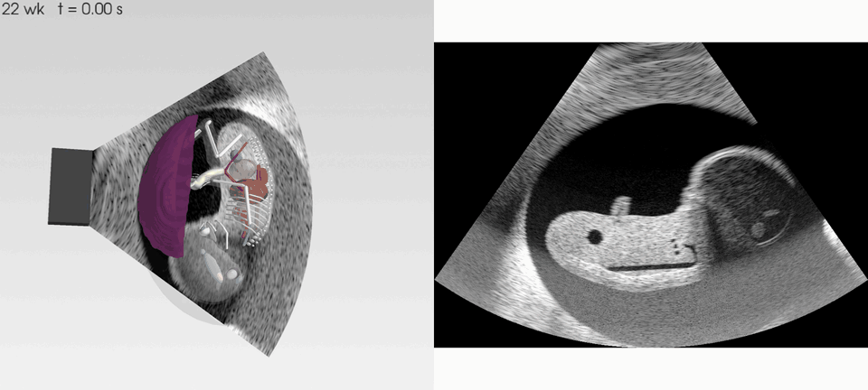
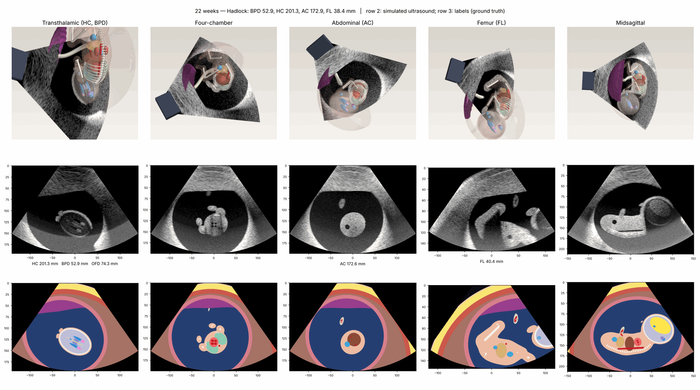
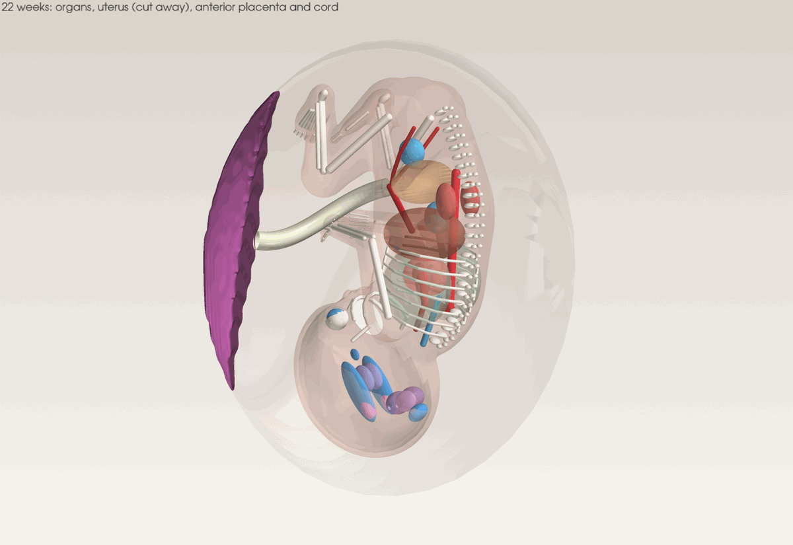
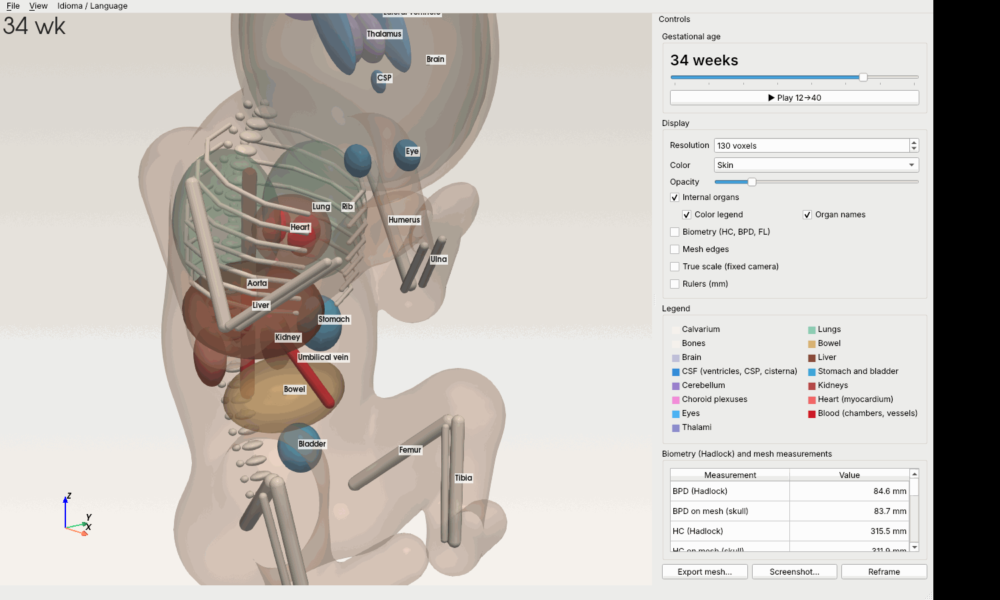
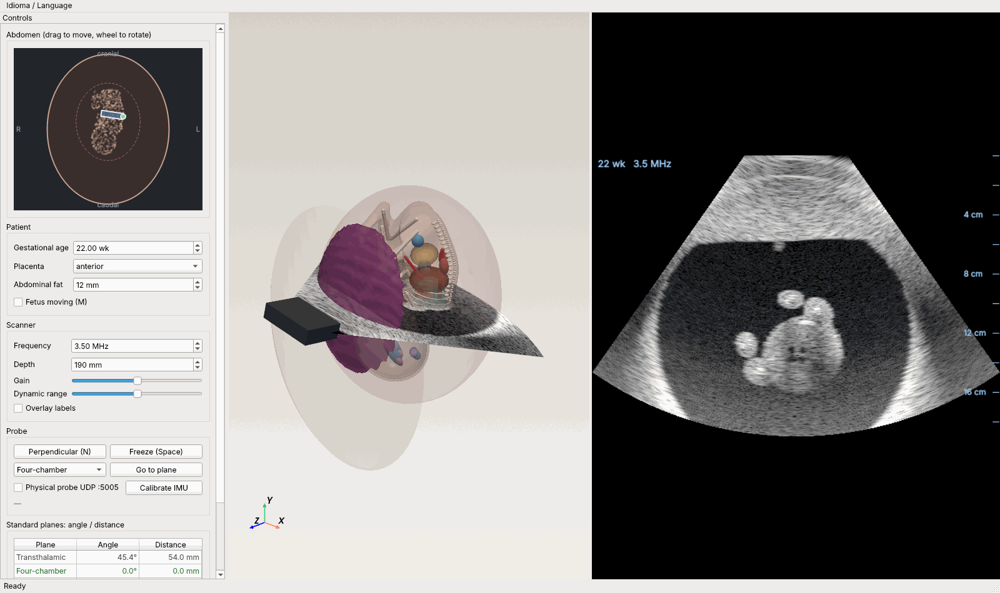

# feto-parametrico

[Español](README.md) · **English**

[](https://github.com/oscarys/feto-parametrico/actions/workflows/pruebas.yml)
[](LICENSE)

A parametric human fetus driven by gestational age, with internal organs and movement
inside a uterus, and a simulator of B-mode obstetric ultrasound for training.



## What it includes

* **Surface model** from Hadlock biometry (BPD, HC, AC, FL), 12 to 40 weeks;
  watertight meshes in millimetres, exportable to STL/OBJ/PLY.
* **3D scene**: skull and brain (ventricles, thalami, cerebellum with vermis, cisterna
  magna, CSP), face with profile, eyes and facial bones, four-chamber heart, lungs,
  liver, stomach, kidneys, bladder, spine, ribs and long bones; uterus, placenta,
  umbilical cord and maternal abdominal wall.
* **Movement**: kicks, startles, head turns, breathing and heartbeat.
* **Simulated ultrasound** with ground truth: standard planes (transthalamic,
  four-chamber, abdominal, femur, midsagittal, transcerebellar, profile, nose-and-lips),
  convex, linear, sector and matrix probes (3D volume, orthogonal slices, biplane and
  face render), measurements on the image, cine loops and labelled batches for
  training.
* **Desktop applications** (PyQt6 + PyVista), in Spanish and English: a viewer of the
  model and a scanning trainer driven by a virtual or physical probe.

| | |
|---|---|
|  |  |
| Standard planes at 22 weeks: scene, ultrasound and labels | Organs, uterus (cut away), placenta and cord |
|  |  |
| `feto-visor`: organs, legend and names | `feto-escaner`: probe on the four-chamber plane |

## Installation

Requires Python 3.10 or later. The recommended way is a virtual environment: on many Linux
distributions a `pip install` outside a virtual environment is refused
(`externally-managed-environment`).

```bash
git clone https://github.com/oscarys/feto-parametrico.git
cd feto-parametrico
python3 -m venv .venv                # once
source .venv/bin/activate            # in every new terminal (Windows: .venv\Scripts\activate)
pip install -e ".[todo]"             # model + VTK + applications + tests
```

`-e` installs in editable mode: changes to the code take effect without reinstalling.
Extras: `vtk` (renders and videos with PyVista), `gui` (PyQt6 applications), `dev`
(pytest). Model and simulation only: `pip install -e .`

On Linux, Qt 6.5+ also needs `libxcb-cursor0` (`sudo apt install libxcb-cursor0`).
On a headless server, renders work with `PYVISTA_OFF_SCREEN=true` or `xvfb-run`.

## Running the applications

Installing creates commands; there are no loose `.py` scripts to run any more. With the
virtual environment activated:

```bash
feto-visor 24 --idioma en            # 3D viewer at 24 weeks, in English
feto-escaner --eg 22 --idioma en     # scanning trainer at 22 weeks, in English
python -m feto_parametrico --idioma en   # lists every available command
```

Without `--idioma`, the language follows the system locale (`LANG`) or the choice saved
from the apps' **Idioma / Language** menu.

Equivalence with the scripts of the first versions:

| Before | Now (installed) | Without installing, from the repository folder |
|---|---|---|
| `python visor_feto.py 24` | `feto-visor 24` | `PYTHONPATH=src python -m feto_parametrico.apps.visor 24` |
| `python escaner.py --eg 22` | `feto-escaner --eg 22` | `PYTHONPATH=src python -m feto_parametrico.apps.escaner --eg 22` |
| `python feto_parametrico.py 20` | `feto-malla 20` | `PYTHONPATH=src python -m feto_parametrico.superficie 20` |
| `python demo_ecografia.py planos` | `feto-eco planos` | `PYTHONPATH=src python -m feto_parametrico.cli.demo_ecografia planos` |
| `python render_pyvista.py serie 12 20` | `feto-render serie 12 20` | `PYTHONPATH=src python -m feto_parametrico.cli.render_pyvista serie 12 20` |
| `python animacion3d.py` | `feto-animacion` | `PYTHONPATH=src python -m feto_parametrico.cli.animacion3d` |
| `python render.py 12 20` | `feto-vista-previa 12 20` | `PYTHONPATH=src python -m feto_parametrico.cli.vista_previa 12 20` |
| `python fuentes_sonda.py` | `feto-sonda-emulador` | `PYTHONPATH=src python -m feto_parametrico.fuentes_sonda` |

The "without installing" form needs the dependencies already installed (for example, the
package installed in another environment).

**If you get `feto-visor: command not found`:** the virtual environment is not activated
in that terminal (`source .venv/bin/activate`) or the package was not installed. Without
activating it, the full path also works: `.venv/bin/feto-visor 24`.

## Quick start

With the virtual environment activated:

| Command | What it does |
|---|---|
| `feto-visor 24` | 3D viewer with a gestational-age slider, organs and biometry |
| `feto-escaner --eg 22` | scanning trainer: probe on the abdomen and live ultrasound |
| `feto-malla 20 -o feto20.stl` | surface mesh (STL/OBJ/PLY) |
| `feto-eco planos --eg 22` | figure of the standard biometry planes with measurements |
| `feto-eco cabeza --eg 22` | transcerebellar, profile and nose-and-lips (TCD, CM, nasal bone) |
| `feto-eco volumen` | matrix probe: orthogonal slices and 3D render of the face |
| `feto-eco lote --n 200` | images, label maps and JSON with biometry for training |
| `feto-render serie 12 20 28 36 40` | fetuses to scale over a ruler |
| `feto-animacion --eg 22` | 3D video of the fetus moving in the uterus |
| `feto-sonda-emulador` | sends a simulated probe over UDP to `feto-escaner --udp` |

Every command accepts `--help`, and `--idioma en` for English text in the apps,
figures and videos. Command names, options and the Python API are in Spanish (`eg` =
gestational age in weeks, `planos` = planes, `lote` = batch).

```python
from feto_parametrico import malla_fetal, biometria
from feto_parametrico.feto3d import Escena
from feto_parametrico.ecografia import plano_estandar, simular, sonda_para, medir_en_imagen

malla = malla_fetal(24)                          # trimesh.Trimesh in mm
esc = Escena(22)                                 # scene at 22 weeks
pose = plano_estandar(esc, "transtalamico")      # probe placed for the transthalamic plane
res = simular(esc, pose, sonda_para(pose))       # B-mode image + label map
medir_en_imagen(res, "transtalamico", 0.3, pose) # {'CC': 201.3, 'DBP_ext': 52.9, ...} (HC, BPD)
```

### Glossary of Spanish names

| In the code | Meaning |
|---|---|
| `EG`, `eg` | gestational age (weeks) |
| `DBP`, `CC`, `CA`, `LF` | BPD, HC, AC, FL |
| `PFE`, `LCC` | estimated fetal weight (EFW), crown-rump length (CRL) |
| `transtalamico`, `cuatro_camaras`, `abdominal`, `femur`, `sagital` | transthalamic, four-chamber, abdominal, femur, midsagittal planes |
| `Escena`, `Postura`, `Movimiento`, `Materno` | scene, pose, movement, maternal parameters |
| `Sonda`, `Adquisicion` | probe, acquisition settings |
| `simular`, `medir_en_imagen` | simulate, measure on the image |
| `bmodo`, `etiquetas` | B-mode image, label map |

## Applications

### feto-visor

```bash
feto-visor 34
feto-visor 34 --idioma en
```

* Gestational-age slider from 12 to 40 weeks; meshes are built in a background
  thread and cached, so revisiting an age is instant.
* **True scale (fixed camera):** the camera stays framed for 40 weeks, so growth is visible.
* **▶ Play 12→40:** steps through every age.
* **Internal organs:** the same organs as the ultrasound simulator, with a color legend
  and floating organ names.
* Biometry overlay (HC plane and outline, BPD, femur axes), mean-curvature coloring,
  opacity, mesh edges, rulers, preset views.
* Table comparing Hadlock values with the measurements on the mesh, volume and EFW.
* Export to STL/OBJ/PLY/VTP; screenshots at twice the resolution.

### feto-escaner

```bash
feto-escaner --eg 22
feto-escaner --eg 28 --udp      # with a physical probe or feto-sonda-emulador
```

* **Left:** top view of the abdomen (drag to move the probe, wheel to rotate it),
  patient settings (gestational age, placenta, abdominal fat, fetal movement), scanner
  settings (frequency, depth, gain, dynamic range, label overlay), and a table with the
  angle and distance from the current plane to each standard plane (green within 10°
  and 4 mm).
* **Centre:** 3D scene with the probe and the image painted on its plane.
* **Right:** live ultrasound (~0.4 s per frame with 128 lines).

| Key | Action |
|---|---|
| arrows | slide the probe (lateral / elevation) |
| Q / E | rotate about the beam |
| W / S | rock, within the image plane |
| A / D | fan, out of the image plane |
| Shift | fine steps |
| N | probe perpendicular to the skin |
| Space | freeze: high-quality image (256 lines) and measurements against Hadlock |
| M | fetal movement on/off |

### Physical probe

`feto-escaner --udp` listens on UDP port 5005 for one JSON object per sample:
position on the physical abdomen (`u`, `v` in −1…1, or `x`, `y` in mm), orientation
as an IMU quaternion (`q = [w, x, y, z]`) or as angles (`giro` = rotation,
`balanceo` = rock, `abanico` = fan), and optional events (`congelar` = freeze,
`descongelar` = unfreeze, `calibrar` = calibrate). An ESP32 with a BNO055/BNO085 IMU
gives the quaternion directly; position can come from a camera tracking an ArUco marker
on the probe. `feto-sonda-emulador` sends a test sweep. Details:
[docs/sonda_fisica.en.md](docs/sonda_fisica.en.md).

### Interface language

Both applications, and the text drawn in figures and videos by the commands, are
available in Spanish and English. The language is chosen, in
order of priority, by `--idioma es|en`, by the **Idioma / Language** menu (which switches
at runtime and remembers the choice), by the `FETO_IDIOMA` environment variable, and by
the system locale (`LANG`); the fallback is Spanish.

The scheme is plain Python with no Qt translation machinery: the Spanish source text is
the key (`tr("Edad gestacional")`), each language has a JSON catalog in
`src/feto_parametrico/traducciones/`, and a missing entry falls back to Spanish. Strings
kept in tables are marked with `N_("…")`. To add a language, copy `en.json` to
`<code>.json`, translate the values and add the code to `IDIOMAS` in `i18n.py`;
`python scripts/cadenas_i18n.py --actualizar` adds new strings to every catalog, and the
tests fail if a catalog is incomplete or a translation drops a `{field}`.

## How it works

**Biometry.** Gestational age sets BPD, HC, AC and FL through the Hadlock et al. (1984)
regressions. The outer edge of the skull matches Hadlock's HC and BPD (the scalp lies
outside it); the abdominal cross-section matches the AC; the ossified femoral shaft
measures exactly FL; foot length equals FL (FL/foot ratio of 1, see
[validation](docs/validacion.en.md#foot)). Proportions not covered by Hadlock are heuristic and editable in
`Proporciones`.

**Geometry.** The body is a smooth union of signed distance functions (ellipsoids and
rounded cones); the surface is extracted with marching cubes, reduced to its largest
connected component and Taubin-smoothed. In the 3D scene every point receives a tissue
label, a body part and local coordinates.

**Ultrasound.** A ray/convolution model: tissue-anchored speckle (it moves with the
fetus), angle-dependent specular reflection, attenuation and interface losses (acoustic
shadowing behind bone, enhancement behind fluid), depth-dependent PSF, electronic noise,
automatic TGC, log compression and scan conversion, plus the label map as ground truth.
Measurements are taken on the simulated image's label map, as on an annotated real image.

**Threads.** VTK is not thread-safe, so the applications' worker threads use NumPy only;
PyVista objects are created and rendered exclusively in the GUI thread. A test checks
that the worker code paths never even import VTK. If a window ever stops responding,
`kill -USR1 <pid>` prints every thread's stack in the application's terminal.

## Validation

At 22 weeks, measured on the simulated ultrasound images:

| Measurement | Hadlock | On the image |
|---|---|---|
| HC | 201.3 mm | 201.3 mm |
| BPD (outer–outer) | 52.9 mm | 52.9 mm |
| AC | 172.9 mm | 172.6 mm |
| FL | 38.4 mm | 40.4 mm (+5 %) |

The surface meshes are watertight from 12 to 40 weeks, with HC and BPD within ~1.2 % of
Hadlock and volumes within a few percent of the estimated fetal weight from 28 weeks
(~10 % low at 20 weeks). FL measured on the image is consistently ~5 % long; the cause
has not been identified yet. Full tables: [docs/validacion.en.md](docs/validacion.en.md).

## Documentation

* [The model](docs/modelo.en.md): biometry, geometry, organs, movement.
* [Ultrasound simulation](docs/ecografia.en.md): pipeline, standard planes, batches.
* [Applications](docs/aplicaciones.en.md): `feto-visor` and `feto-escaner`.
* [Physical probe](docs/sonda_fisica.en.md): UDP protocol, calibration, emulator.
* [Validation](docs/validacion.en.md): measurements against Hadlock, foot, anatomy.

## Repository layout

```
src/feto_parametrico/
├── superficie.py      Hadlock biometry and surface mesh
├── feto3d.py          articulated fetus with organs + maternal scene (labelled SDF)
├── movimiento.py      poses over time
├── tejidos.py         acoustic properties per tissue
├── ecografia.py       B-mode simulator, standard planes, image measurements
├── sonda_control.py   virtual probe state and plane feedback
├── fuentes_sonda.py   physical probe over UDP and emulator
├── i18n.py            translation scheme (tr, N_)
├── traducciones/      language catalogs (en.json)
├── mallas_np.py       NumPy meshes (safe in worker threads)
├── vista3d.py         scene meshes (NumPy and PyVista)
├── feto_pv.py         PyVista helpers for the viewer and renders
├── apps/              visor.py, escaner.py, comun.py (PyQt6)
└── cli/               render_pyvista.py, animacion3d.py, demo_ecografia.py, vista_previa.py
scripts/               docs media regeneration, string extraction
tests/                 tests (pytest)
docs/                  documentation and images
```

## Tests

```bash
pytest
```

They check the biometry against the Hadlock table, mesh watertightness, the femur/foot
ratio, that no organ protrudes from the skin, HC measured on the simulated ultrasound,
that worker threads do not use VTK, and that the translation catalogs are complete and
keep every `{field}`.

## Limitations

This is a teaching model: primitive-based anatomy (ellipsoids and capsules), heuristic
proportions where Hadlock has no data, approximate acoustic properties, no refraction or
reverberation, and illustrative fetal kinematics. It is not a clinical tool.

## References

* Hadlock FP, Deter RL, Harrist RB, Park SK. Estimating fetal age: computer-assisted
  analysis of multiple fetal growth parameters. *Radiology* 1984;152:497–501,
  doi:[10.1148/radiology.152.2.6739822](https://doi.org/10.1148/radiology.152.2.6739822).
* Hadlock FP, Harrist RB, Sharman RS, Deter RL, Park SK. Estimation of fetal weight
  with the use of head, body, and femur measurements. *Am J Obstet Gynecol*
  1985;151:333–337, doi:[10.1016/0002-9378(85)90298-4](https://doi.org/10.1016/0002-9378(85)90298-4).
* Femur/foot ratio: see [validation](docs/validacion.en.md#foot).
* Fetal foot length (Merz et al.): *Ultraschall in der Medizin* 2000,
  doi:[10.1055/s-2000-12986](https://doi.org/10.1055/s-2000-12986).

## License

[GPL-3.0-or-later](LICENSE). If you use it in academic work, see
[CITATION.cff](CITATION.cff).
