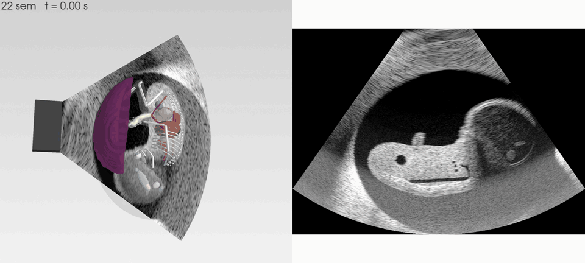
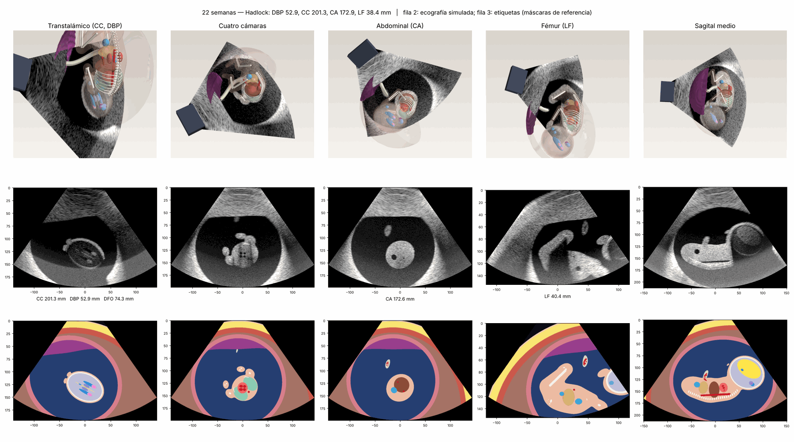
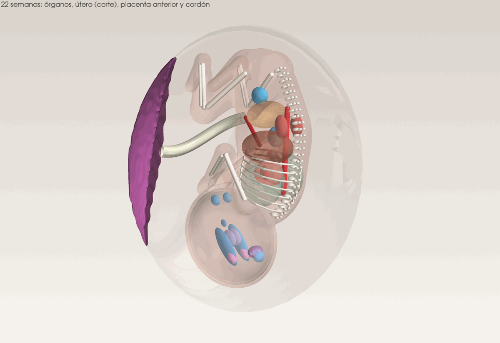
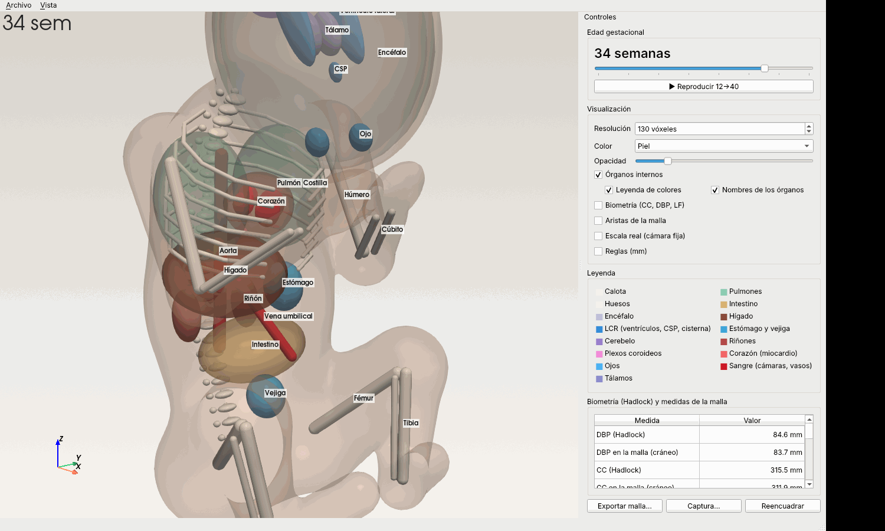
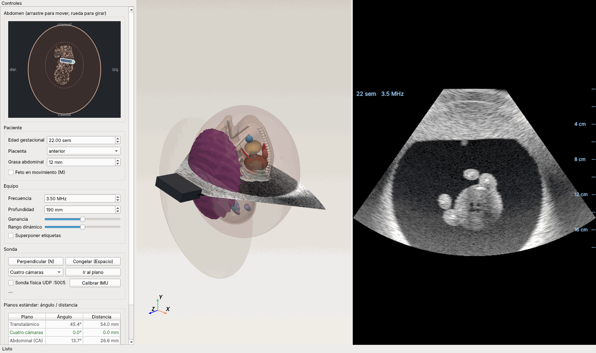

# feto-parametrico

**Español** · [English](README.en.md)

[](https://github.com/oscarys/feto-parametrico/actions/workflows/pruebas.yml)
[](LICENSE)

Feto humano paramétrico por edad gestacional, con órganos y movimiento, dentro de un
útero, y simulación de ecografía obstétrica modo B para entrenamiento.



## Qué incluye

* **Modelo de superficie** a partir de la biometría de Hadlock (DBP, CC, CA, LF), de 12
  a 40 semanas; mallas herméticas en mm, exportables a STL/OBJ/PLY.
* **Escena 3D**: cráneo y encéfalo (ventrículos, tálamos, cerebelo, CSP), corazón con
  cuatro cámaras, pulmones, hígado, estómago, riñones, vejiga, columna, costillas y
  huesos largos; útero, placenta, cordón y pared abdominal materna.
* **Movimiento**: patadas, sobresaltos, giros de cabeza, respiración y latido.
* **Ecografía simulada** con máscaras de referencia: planos estándar (transtalámico, cuatro
  cámaras, abdominal, fémur, sagital), medidas sobre la imagen, cines y lotes
  etiquetados para entrenamiento.
* **Aplicaciones de escritorio** (PyQt6 + PyVista), en español e inglés: un visor del
  modelo y un simulador de exploración con sonda virtual o física.

| | |
|---|---|
|  |  |
| Planos estándar a 22 semanas: escena, ecografía y etiquetas | Órganos, útero (corte), placenta y cordón |
|  |  |
| `feto-visor`: órganos, leyenda y nombres | `feto-escaner`: sonda en el plano de cuatro cámaras |

## Instalación

Requiere Python 3.10 o posterior. La forma recomendada es un entorno virtual: en muchas
distribuciones de Linux un `pip install` fuera de un entorno virtual se rechaza
(`externally-managed-environment`).

```bash
git clone https://github.com/oscarys/feto-parametrico.git
cd feto-parametrico
python3 -m venv .venv                # una sola vez
source .venv/bin/activate            # en cada terminal nueva (Windows: .venv\Scripts\activate)
pip install -e ".[todo]"             # modelo + VTK + aplicaciones + pruebas
```

`-e` instala en modo editable: los cambios al código se ven sin reinstalar. Extras:
`vtk` (renders y videos con PyVista), `gui` (aplicaciones PyQt6), `dev` (pytest). Sólo
el modelo y la simulación: `pip install -e .`

En Linux, Qt 6.5+ necesita además `libxcb-cursor0` (`sudo apt install libxcb-cursor0`).
En un servidor sin pantalla, los renders funcionan con `PYVISTA_OFF_SCREEN=true` o `xvfb-run`.

## Cómo ejecutar las aplicaciones

La instalación crea comandos; ya no hay que correr archivos `.py` sueltos. Con el entorno
virtual activado:

```bash
feto-visor 24                        # visor 3D a las 24 semanas
feto-escaner --eg 22                 # simulador de exploración a las 22 semanas
feto-escaner --eg 22 --idioma en     # la misma aplicación en inglés
python -m feto_parametrico           # lista todos los comandos disponibles
```

Equivalencias con los scripts de las primeras versiones:

| Antes | Ahora (instalado) | Sin instalar, desde la carpeta del repositorio |
|---|---|---|
| `python visor_feto.py 24` | `feto-visor 24` | `PYTHONPATH=src python -m feto_parametrico.apps.visor 24` |
| `python escaner.py --eg 22` | `feto-escaner --eg 22` | `PYTHONPATH=src python -m feto_parametrico.apps.escaner --eg 22` |
| `python feto_parametrico.py 20` | `feto-malla 20` | `PYTHONPATH=src python -m feto_parametrico.superficie 20` |
| `python demo_ecografia.py planos` | `feto-eco planos` | `PYTHONPATH=src python -m feto_parametrico.cli.demo_ecografia planos` |
| `python render_pyvista.py serie 12 20` | `feto-render serie 12 20` | `PYTHONPATH=src python -m feto_parametrico.cli.render_pyvista serie 12 20` |
| `python animacion3d.py` | `feto-animacion` | `PYTHONPATH=src python -m feto_parametrico.cli.animacion3d` |
| `python render.py 12 20` | `feto-vista-previa 12 20` | `PYTHONPATH=src python -m feto_parametrico.cli.vista_previa 12 20` |
| `python fuentes_sonda.py` | `feto-sonda-emulador` | `PYTHONPATH=src python -m feto_parametrico.fuentes_sonda` |

La forma "sin instalar" necesita las dependencias ya instaladas (por ejemplo, el
paquete instalado en otro entorno).

**Si aparece `feto-visor: command not found`:** el entorno virtual no está activado en
esa terminal (`source .venv/bin/activate`) o el paquete no se instaló. Sin activarlo,
también funciona la ruta completa: `.venv/bin/feto-visor 24`.

## Uso rápido

Con el entorno virtual activado:

| Comando | Qué hace |
|---|---|
| `feto-visor 24` | visor 3D con deslizador de edad gestacional, órganos y biometría |
| `feto-escaner --eg 22` | simulador de exploración: sonda sobre el abdomen y ecografía en vivo |
| `feto-malla 20 -o feto20.stl` | malla de superficie (STL/OBJ/PLY) |
| `feto-eco planos --eg 22` | figura de los cinco planos estándar con medidas |
| `feto-eco lote --n 200` | imágenes, etiquetas y JSON con biometría para entrenamiento |
| `feto-render serie 12 20 28 36 40` | fetos a escala sobre una regla |
| `feto-animacion --eg 22` | video 3D del feto moviéndose en el útero |
| `feto-sonda-emulador` | envía por UDP una sonda simulada a `feto-escaner --udp` |

Cada comando acepta `--help` y `--idioma es|en`, que elige el idioma de las aplicaciones
y del texto en figuras y videos.

```python
from feto_parametrico import malla_fetal, biometria
from feto_parametrico.feto3d import Escena
from feto_parametrico.ecografia import plano_estandar, simular, sonda_para, medir_en_imagen

malla = malla_fetal(24)                          # trimesh.Trimesh en mm
esc = Escena(22)
pose = plano_estandar(esc, "transtalamico")
res = simular(esc, pose, sonda_para(pose))
medir_en_imagen(res, "transtalamico", 0.3, pose)  # {'CC': 201.3, 'DBP_ext': 52.9, ...}
```

## Documentación

* [El modelo](docs/modelo.md): biometría, geometría, órganos, movimiento.
* [Simulación de ecografía](docs/ecografia.md): tubería, planos estándar, lotes.
* [Aplicaciones](docs/aplicaciones.md): `feto-visor` y `feto-escaner`, teclado.
* [Sonda física](docs/sonda_fisica.md): protocolo UDP, calibración, emulador.
* [Validación](docs/validacion.md): medidas frente a Hadlock, pie, anatomía.
* [Idiomas](docs/aplicaciones.md#idioma-de-la-interfaz): esquema de traducción de las aplicaciones.

## Estructura

```
src/feto_parametrico/
├── superficie.py      biometría de Hadlock y malla de superficie
├── feto3d.py          feto articulado con órganos + escena materna (SDF etiquetada)
├── movimiento.py      posturas en función del tiempo
├── tejidos.py         propiedades acústicas por tejido
├── ecografia.py       simulador modo B, planos estándar, medidas en la imagen
├── sonda_control.py   estado de la sonda virtual y retroalimentación de planos
├── fuentes_sonda.py   sonda física por UDP y emulador
├── i18n.py            esquema de traducción (tr, N_)
├── traducciones/      catálogos de idiomas (en.json)
├── mallas_np.py       mallas con NumPy (seguras en hilos de trabajo)
├── vista3d.py         mallas de la escena (NumPy y PyVista)
├── feto_pv.py         utilidades PyVista del visor y los renders
├── apps/              visor.py, escaner.py, comun.py (PyQt6)
└── cli/               render_pyvista.py, animacion3d.py, demo_ecografia.py, vista_previa.py
scripts/               regenerar imágenes de la documentación, extraer textos
tests/                 pruebas (pytest)
docs/                  documentación e imágenes
```

## Pruebas

```bash
pytest
```

Comprueban la biometría frente a la tabla de Hadlock, la hermeticidad de las mallas,
la razón fémur/pie, que ningún órgano sobresalga de la piel, la CC medida sobre la
ecografía simulada, que los hilos de trabajo no usen VTK y que los catálogos de
traducción estén completos y conserven los `{campos}`.

## Limitaciones

Es un modelo didáctico: anatomía de primitivas (elipsoides y cápsulas), proporciones
heurísticas donde no hay datos de Hadlock, propiedades acústicas aproximadas, sin
refracción ni reverberación, y cinemática fetal ilustrativa. No es una herramienta
clínica.

## Referencias

* Hadlock FP, Deter RL, Harrist RB, Park SK. Estimating fetal age: computer-assisted
  analysis of multiple fetal growth parameters. *Radiology* 1984;152:497–501.
* Hadlock FP, Harrist RB, Sharman RS, Deter RL, Park SK. Estimation of fetal weight
  with the use of head, body, and femur measurements. *Am J Obstet Gynecol*
  1985;151:333–337.
* Longitud del pie fetal y razón fémur/pie: *Ultraschall in der Medizin* 2000,
  doi:[10.1055/s-2000-12986](https://doi.org/10.1055/s-2000-12986).

## Licencia

[GPL-3.0-or-later](LICENSE). Si lo usas en un trabajo académico, ver
[CITATION.cff](CITATION.cff).
