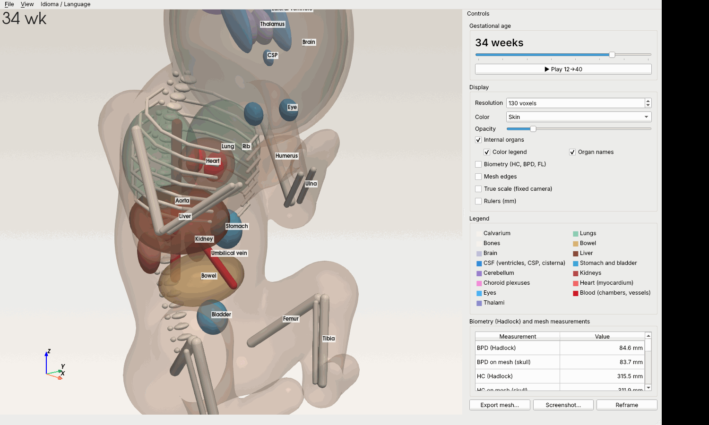
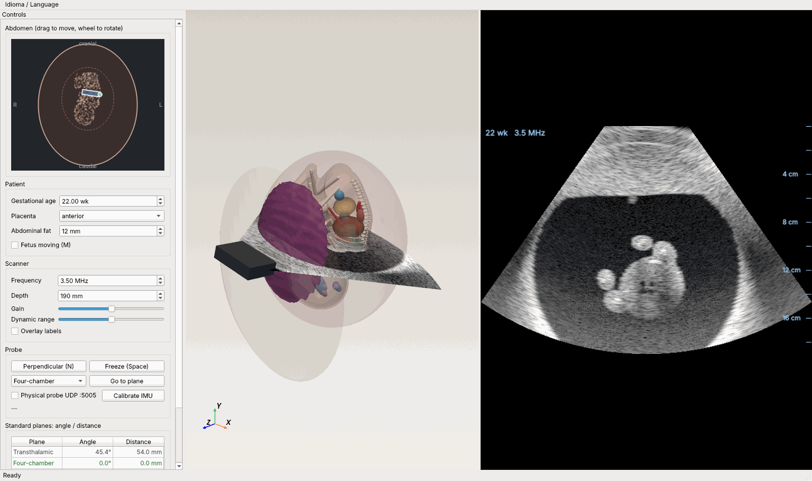

# Applications

[Español](aplicaciones.md) · **English**

The commands in this document exist after `pip install -e ".[todo]"` inside an activated
virtual environment; see [Running the applications](../README.en.md#running-the-applications)
(including the no-install form, `PYTHONPATH=src python -m feto_parametrico.apps.visor`).

Both applications are available in Spanish and English (see [Interface language](#interface-language)).

## feto-visor

```bash
feto-visor                  # 20 weeks
feto-visor 34 --idioma en
```



* Gestational-age slider from 12 to 40 weeks in half-week steps; the mesh is built in a
  background thread and cached, so revisiting an age is instant.
* **True scale (fixed camera):** the camera stays framed for a 40-week fetus and does
  not move, so growth is visible.
* **▶ Play 12→40:** steps through every age.
* **Internal organs:** the same organs as the ultrasound simulator; the skin drops to
  25 % opacity. Options: color legend (side panel) and organ names as labels in the 3D view.
* Biometry overlay (HC plane and outline, BPD, femur axes), mean-curvature coloring,
  opacity, mesh edges, rulers in mm, preset views (*View* menu).
* Table with the Hadlock biometry against the measurements on the mesh, volume and EFW.
* Export to STL/OBJ/PLY/VTP; PNG screenshots at twice the resolution.

## feto-escaner

```bash
feto-escaner --eg 22 --idioma en
feto-escaner --eg 28 --udp     # with a physical probe or feto-sonda-emulador
```



* **Left:** top view of the abdomen (drag to move the probe, wheel to rotate it),
  patient settings (GA, placenta, abdominal fat, fetal movement), scanner settings
  (frequency, depth, gain, dynamic range, label overlay), and a table with the angle and
  distance from the current plane to each standard plane (green within 10° and 4 mm).
* **Centre:** 3D scene with the probe and the image painted on its plane.
* **Right:** live ultrasound (~0.4 s per frame with 128 lines).

| Key | Action |
|---|---|
| arrows | slide the probe (lateral / elevation) |
| Q / E | rotate about the beam |
| W / S | rock, within the image plane |
| A / D | fan, out of the image plane |
| Shift | fine steps |
| N | probe perpendicular to the skin |
| Space | freeze: high-quality image (256 lines) and measurements against Hadlock |
| M | fetal movement on/off |

The physical probe is described in [sonda_fisica.en.md](sonda_fisica.en.md).

## Interface language

Both applications are in Spanish and English, and so is the text the commands draw in
figures and videos (`feto-render`, `feto-eco`, `feto-animacion`, `feto-vista-previa`).
The language is chosen, in this order: the `--idioma es|en` option, the applications'
**Idioma / Language** menu (switches at runtime and remembers the choice), the
`FETO_IDIOMA` environment variable and the system locale
(`LANG`); if nothing matches, Spanish.

The scheme is plain Python, without Qt's translation machinery (`.ts`/`.qm`):

* The Spanish source text **is the key**: `tr("Edad gestacional")`. Texts with values use
  named fields: `tr("{eg:g} semanas", eg=22)` → "22 weeks".
* Each language has a JSON catalog in `src/feto_parametrico/traducciones/`; a missing
  entry is shown in Spanish.
* Texts kept in tables (menus, plane names, legend, labels) are marked with `N_("…")`
  and translated when displayed.
* When the language is changed from the menu, the window is rebuilt keeping the main
  state (gestational age, probe position, physical probe connection).

To add a language: copy `en.json` to `<code>.json`, translate the values and add the
code to `IDIOMAS` in `i18n.py`. To keep the catalogs up to date:

```bash
python scripts/cadenas_i18n.py               # report: missing, untranslated, stale
python scripts/cadenas_i18n.py --actualizar  # add new keys (empty) to every catalog
```

The tests fail if a catalog is incomplete, has keys no longer in the code, or a
translation drops a `{field}`.

## Requirements

```bash
pip install -e ".[gui]"
sudo apt install libxcb-cursor0     # Linux: needed by Qt 6.5+
```

## If a window stops responding

Worker threads use NumPy only; PyVista/VTK is used exclusively in the GUI thread, with a
single `render()` per update. If a window still freezes, from another terminal:

```bash
kill -USR1 <pid>
```

prints every thread's stack in the application's terminal.
