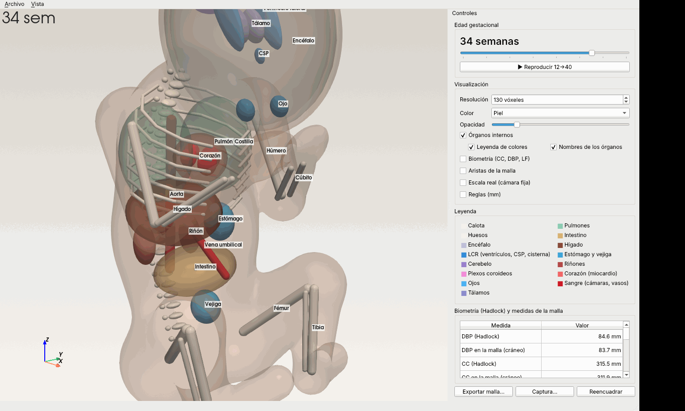
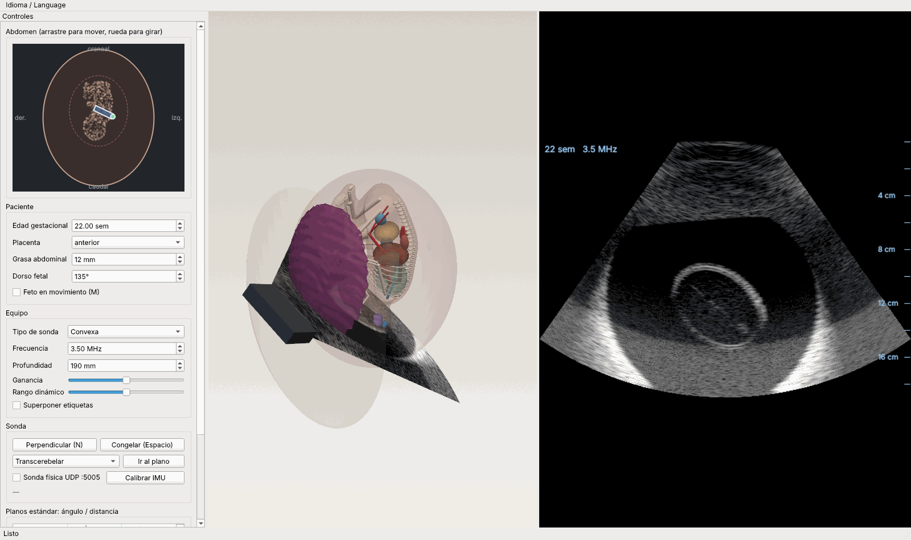

# Aplicaciones

**Español** · [English](aplicaciones.en.md)

Los comandos de este documento existen tras `pip install -e ".[todo]"` dentro de un entorno
virtual activado; ver [Cómo ejecutar las aplicaciones](../README.md#cómo-ejecutar-las-aplicaciones)
(incluye la forma sin instalar, `PYTHONPATH=src python -m feto_parametrico.apps.visor`).

## feto-visor

```bash
feto-visor          # 20 semanas
feto-visor 34
```



* Deslizador de 12 a 40 semanas en pasos de media semana; la malla se genera en un
  hilo aparte y se guarda en caché, así que volver a una edad ya vista es inmediato.
* **Escala real (cámara fija):** la cámara queda encuadrada al tamaño de 40 semanas y
  no se mueve, de modo que se aprecia el crecimiento.
* **▶ Reproducir 12→40:** recorre todas las edades.
* **Órganos internos:** los mismos órganos del simulador de ecografía; la piel pasa a
  25 % de opacidad. Opciones: leyenda de colores (panel lateral) y nombres de los
  órganos como rótulos en la vista 3D.
* Biometría superpuesta (plano y contorno de la CC, DBP, ejes femorales), color por
  curvatura media, opacidad, aristas, reglas en mm, vistas predefinidas (menú *Vista*).
* Tabla con la biometría de Hadlock frente a lo medido en la malla, volumen y PFE.
* Exportar a STL/OBJ/PLY/VTP; captura PNG al doble de resolución.

## feto-escaner

```bash
feto-escaner --eg 22
feto-escaner --eg 28 --udp     # con sonda física o con feto-sonda-emulador
```



* **Izquierda:** mapa del abdomen visto desde arriba (arrastrar = mover la sonda,
  rueda = girarla), parámetros de la paciente (EG, placenta, grasa abdominal, feto en
  movimiento) y del equipo (tipo de sonda, frecuencia, profundidad, ganancia, rango
  dinámico, superponer etiquetas), y una tabla con el ángulo y la distancia del plano actual a
  cada plano estándar (verde dentro de 10° y 4 mm).
* **Centro:** escena 3D con la sonda y la imagen pintada sobre su plano.
* **Derecha:** la ecografía en vivo (~0.4 s por cuadro con 128 líneas).

| Tecla | Acción |
|---|---|
| flechas | deslizar la sonda (lateral / elevación) |
| Q / E | girar alrededor del haz |
| W / S | balanceo (*rock*), en el plano de la imagen |
| A / D | abanico (*fan*), fuera del plano |
| Mayús | pasos finos |
| N | sonda perpendicular a la piel |
| Espacio | congelar: imagen de alta calidad (256 líneas) y medidas frente a Hadlock |
| M | feto en movimiento sí/no |

La sonda física se describe en [sonda_fisica.md](sonda_fisica.md).

## Idioma de la interfaz

Las dos aplicaciones están en español e inglés, igual que el texto que los comandos
dibujan en figuras y videos (`feto-render`, `feto-eco`, `feto-animacion`,
`feto-vista-previa`). El idioma se elige, en este orden:
la opción `--idioma es|en`, el menú **Idioma / Language** de las aplicaciones (cambia en
caliente y recuerda la elección), la variable `FETO_IDIOMA` y la configuración regional del sistema (`LANG`);
si nada coincide, español.

El esquema es Python puro, sin la maquinaria de traducción de Qt (`.ts`/`.qm`):

* El texto fuente en español **es la clave**: `tr("Edad gestacional")`. Los textos con
  valores usan campos con nombre: `tr("{eg:g} semanas", eg=22)`.
* Cada idioma tiene un catálogo JSON en `src/feto_parametrico/traducciones/`; si falta
  una entrada se muestra el español.
* Los textos que viven en tablas (menús, nombres de planos, leyenda, rótulos) se marcan
  con `N_("…")` y se traducen al mostrarse.
* Al cambiar de idioma desde el menú, la ventana se reconstruye conservando el estado
  principal (edad gestacional, posición de la sonda, sonda física).

Para agregar un idioma: copiar `en.json` a `<código>.json`, traducir los valores y
añadir el código a `IDIOMAS` en `i18n.py`. Para mantener los catálogos al día:

```bash
python scripts/cadenas_i18n.py               # informe: faltantes, sin traducir, sobrantes
python scripts/cadenas_i18n.py --actualizar  # agrega las claves nuevas (vacías) a cada catálogo
```

Las pruebas fallan si un catálogo está incompleto, tiene claves que ya no existen o una
traducción pierde un `{campo}`.

## Requisitos de las aplicaciones

```bash
pip install -e ".[gui]"
sudo apt install libxcb-cursor0     # Linux: Qt 6.5+ lo necesita
```

## Si una ventana deja de responder

Los hilos de trabajo sólo usan NumPy; PyVista/VTK se usa únicamente en el hilo de la
interfaz, con un solo `render()` por actualización. Si aun así una ventana se bloquea,
desde otra terminal:

```bash
kill -USR1 <pid>
```

imprime en la terminal de la aplicación la pila de todos los hilos.
