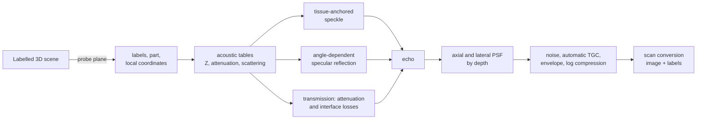
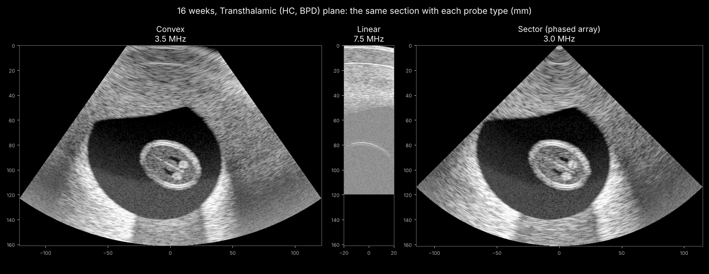
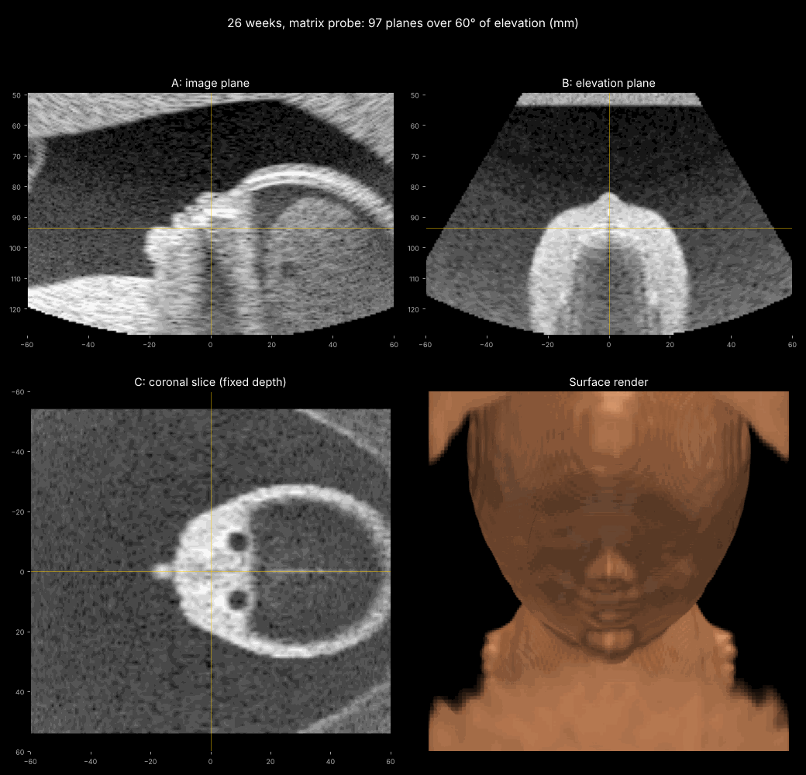
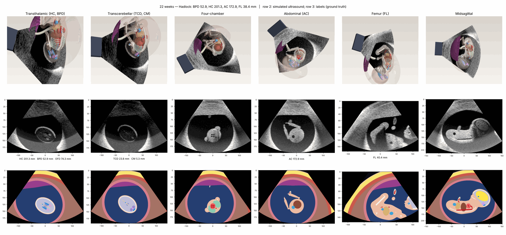
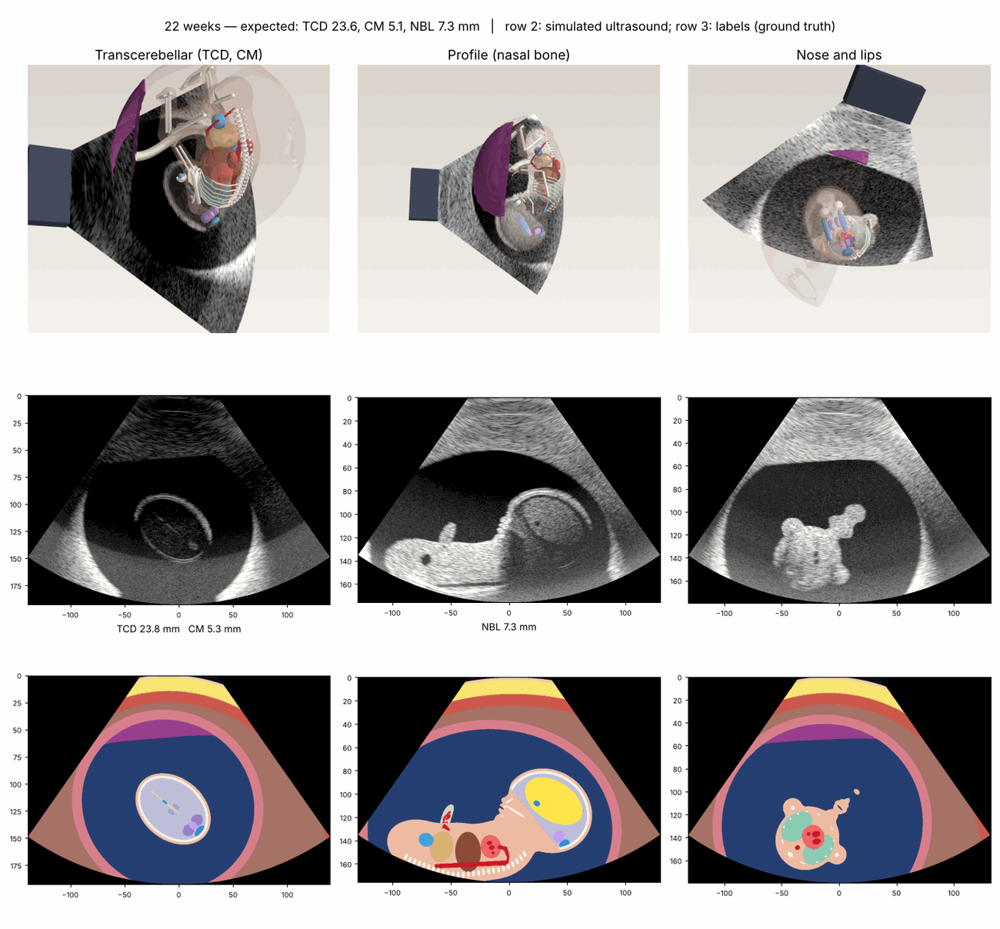
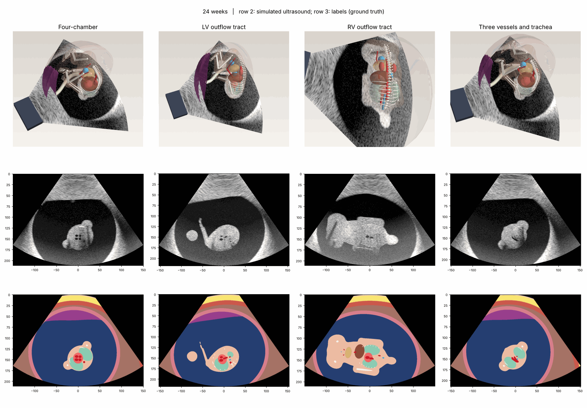
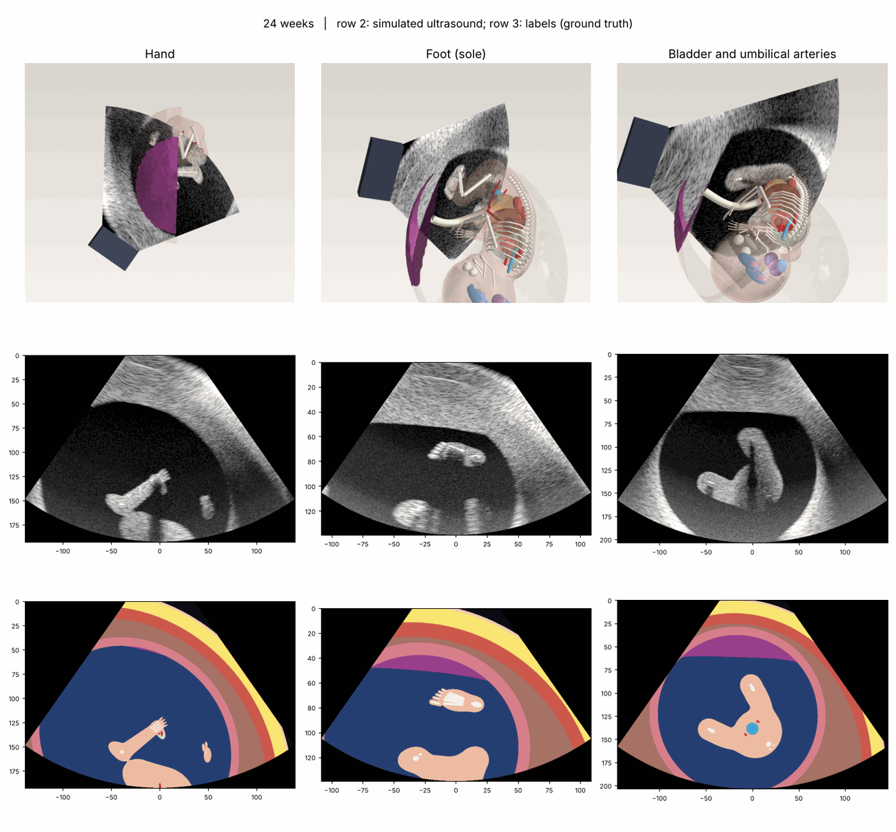
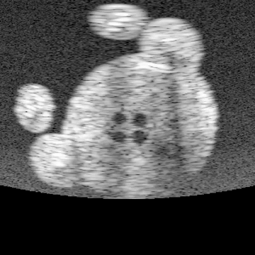
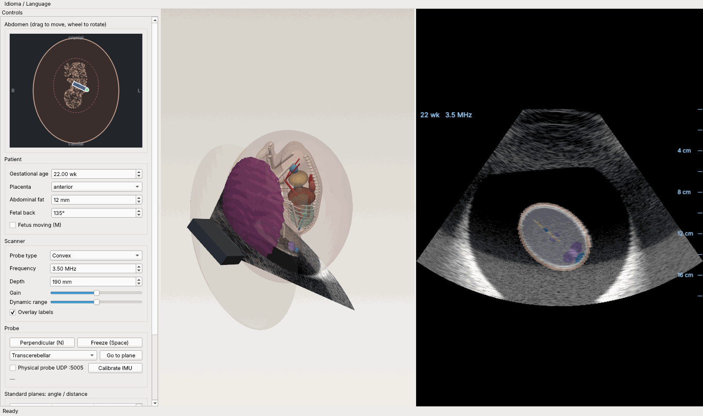

# Ultrasound simulation

[Español](ecografia.md) · **English**

`ecografia.py` simulates B-mode images with a ray/convolution model: a probe (convex,
linear or sector) resting on the maternal skin samples a plane through the labelled 3D
scene (`feto3d.Escena`).



## Stages

| Stage | What it does |
|---|---|
| Sampling | the scene is evaluated on the beam grid (lines × depth), according to the probe geometry |
| Speckle | complex scatterers hashed from the local 3D coordinates of each body part: speckle moves with the fetus and is deterministic |
| Specular | radial derivative of ln Z weighted by cosᵖ of the angle between the beam and the interface normal |
| Transmission | round-trip attenuation + reflection losses; produces acoustic shadowing behind bone and enhancement behind fluid |
| PSF | Gaussian, axial (scales with 1/f₀) and lateral, widening away from the focus |
| Receiver | electronic noise, automatic TGC (compensates the median attenuation across lines, so amniotic fluid stays black), log compression. On the linear probe the TGC stops at 50 dB (`Sonda.tgc_max_db`): beyond its reach the image turns into noise, as on a real scanner |
| Output | Cartesian image (sector or rectangle) and label map (ground truth) |
| Slice thickness | optional: coherent sum of several planes in elevation (`Adquisicion(elevacion=(-1, 0, 1))`) |

## Probe types

`Sonda.geometria` chooses how the beam lines are laid out; `sonda_tipo(geometria)` gives a
probe with the typical values of each type and `sonda_para(pose, geometria=...)` fits it to
the target depth.

| Type | Lines | Image | Typical frequency | Depth | Use |
|---|---|---|---|---|---|
| `convexa` (convex) | fan from a 50 mm radius arc, 70° | sector with a curved top | 3.5 MHz (2–6) | 160 mm (80–240) | routine obstetric scanning |
| `lineal` (linear) | parallel, spread over 40 mm | rectangle | 7.5 MHz (5–12) | 70 mm (30–120) | structures close to the wall: early pregnancy, superficial detail |
| `sectorial` (sector, phased array) | fan from an almost point-like footprint, 90° | sector with an apex | 3.0 MHz (2–5) | 150 mm (60–240) | small acoustic window; echocardiography |
| `matricial` (matrix) | like the convex probe (40 mm radius), plus 60° in elevation | sector; volume and biplane | 3.5 MHz (2–6) | 160 mm (80–240) | 3D/4D ultrasound: face, orthogonal slices |

The linear probe shows finer detail (higher frequency, finer PSF), but attenuation grows
with frequency and it does not reach far: in the figure, with the same plane at 16
weeks, the skull barely shows below the maternal wall, among the noise. The sector probe
gets in through a small window at the cost of a narrow near field.



## Matrix probe: volume and biplane

The `matricial` (matrix, 2D array) probe gives the same image as a convex probe and
also sweeps a 60° fan in elevation. `volumen.simular_volumen` simulates 97 planes tilted
about the probe's lateral axis (in parallel, with the central plane's grey scale) and
resamples them onto a 0.6 mm Cartesian grid in a box around the target, together with
its label volume. It takes about 15 s.

* **Orthogonal slices (MPR):** A, the image plane; B, the elevation plane
  (perpendicular to A, sharing the central beam); C, a coronal slice at fixed depth.
  They cross at a point moved with sliders or a click.
* **Surface render:** the volume is smoothed (like a scanner's filter), clipped in front
  by a render box that starts in the amniotic fluid in front of the target, and drawn
  transparent for dark voxels (fluid) and opaque for tissue, in sepia. Threshold and box
  start are adjustable.
* **Biplane:** two live planes at 90° sharing the central beam
  (`volumen.pose_biplano`), on the same grey scale.

To see the face, the fetus has to face the probe: in the figure, back posterior (180°)
and the head slightly extended.



## Standard planes

`plano_estandar(scene, name)` places the probe on the skin where the requested plane can
be seen, with the beam inside the plane and as perpendicular as possible to the anterior
maternal wall:

| Name | Plane | Measurement on the image |
|---|---|---|
| `transtalamico` | axial plane of the head at the level of the thalami | HC, BPD, OFD |
| `transcerebelar` (transcerebellar) | oblique plane through the CSP and the cerebellum | TCD, CM (cisterna magna) |
| `cuatro_camaras` | axial plane of the thorax at the level of the heart (four-chamber) | — |
| `abdominal` | axial plane of the abdomen at the level of the stomach | AC |
| `femur` | plane containing the more anterior femur | FL |
| `sagital` | midsagittal plane of the trunk | — |
| `perfil` (profile) | midsagittal plane of the face | NBL (nasal bone) |
| `nariz_labios` (nose and lips) | coronal plane tangent to the face, through the nose and chin | — (upper lip, nostrils) |
| `tsvi` (LVOT) | through the left ventricle and the ascending aorta | — (left outflow tract) |
| `tsvd` (RVOT) | through the right ventricle and the pulmonary trunk | — (right outflow tract) |
| `tres_vasos` (three vessels) | axial plane of the upper mediastinum | — (pulmonary artery, aorta, SVC and trachea) |
| `vejiga` (bladder) | axial plane of the pelvis through the bladder | — (umbilical arteries beside it) |
| `mano` (hand) | plane of the palm | — (count fingers) |
| `pie` (foot) | plane of the sole | — (count toes) |

In the new heart and limb planes the probe turns within the plane until it finds an
acoustic window (the central beam crossing the least bone: `pose_con_ventana`), as a
sonographer would.

`medir_en_imagen` (measure on image) measures on the label map of the simulated image,
not on the model, just as one would on an annotated real image. It returns Spanish keys:
`CC` (HC), `DBP_ext` (BPD, outer–outer), `DFO` (OFD), `CA` (AC), `LF` (FL), `DTC` (TCD),
`CM` (cisterna magna), `HN` (NBL).



Head and face planes (`feto-eco cabeza`):



Heart (`feto-eco corazon`) and limbs (`feto-eco miembros`):





| Four-chamber cine (heartbeat) | Label overlay in `feto-escaner` |
|---|---|
|  |  |

## Usage

```python
from feto_parametrico.feto3d import Escena, Materno
from feto_parametrico.movimiento import Movimiento
from feto_parametrico.ecografia import plano_estandar, simular, sonda_para, medir_en_imagen

mov = Movimiento(semilla=0)                                     # seeded movement
esc = Escena(22, mov.en(1.5), mat=Materno(placenta="posterior"))  # 22 weeks, pose at t = 1.5 s
pose = plano_estandar(esc, "transtalamico")
res = simular(esc, pose, sonda_para(pose))                      # probe depth fitted to the target
res["bmodo"], res["etiquetas"], medir_en_imagen(res, "transtalamico", 0.3, pose)
```

```bash
feto-eco planos --eg 22        # figure of the biometry planes with measurements
feto-eco cabeza --eg 22        # transcerebellar, profile and nose-and-lips (TCD, CM, NBL)
feto-eco corazon --eg 24       # four-chamber, outflow tracts and three vessels
feto-eco miembros --eg 24      # hand, foot and bladder with the umbilical arteries
feto-eco latido --eg 22        # four-chamber cine (heartbeat and breathing)
feto-eco combinado --eg 22     # 3D + ultrasound with a fixed probe and a moving fetus
feto-eco lote --n 200          # images, label maps and JSON for training
feto-eco planos --sonda lineal # the biometry planes with another probe (lineal or sectorial)
feto-eco sondas                # one plane with all three probes (16 weeks by default)
feto-eco volumen               # matrix probe: slices A, B, C and render of the face (26 weeks)
feto-eco planos --eg 22 --idioma en   # the figure with English text
```

The `lote` (batch) mode randomizes the GA (18–34 weeks), the pose, the placenta, the
maternal fat thickness, the plane (with ±12° tilt), the frequency, the gain and the
dynamic range. Some samples come out dark or poorly placed, like real failed
acquisitions; filter them if you use the batch for training. Each sample is written as
`*_img.png` (B-mode), `*_etq.png` (label map, tissue index + 1) and an entry in
`etiquetas.json` with the plane, the GA, the Hadlock biometry, the measurements on the
image and the acquisition settings.

`lote` also accepts `--sonda`; the frequency is drawn at random within the probe type's
range.

## Limitations

* No refraction, reverberation or side lobes.
* Approximate acoustic properties, intended for a teaching simulator.
* FL measured on the image is ~5 % long (see [validation](validacion.en.md)).
* The cardiac chambers are small, so the heartbeat is subtle in the four-chamber cine.
