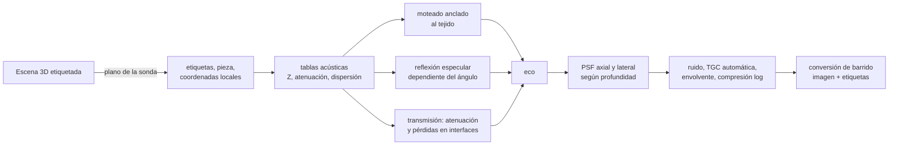
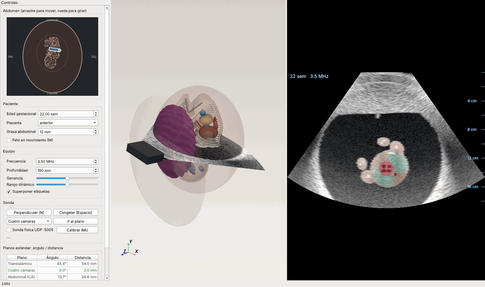

# Simulación de ecografía

**Español** · [English](ecografia.en.md)

`ecografia.py` simula imágenes modo B con un modelo de rayos y convolución: una sonda
convexa apoyada en la piel materna muestrea un plano dentro de la escena 3D
etiquetada (`feto3d.Escena`).



## Etapas

| Etapa | Qué hace |
|---|---|
| Muestreo | la escena se evalúa en la malla polar del haz (líneas × profundidad) |
| Moteado | dispersores complejos con hash de las coordenadas locales 3D de cada pieza: el moteado se mueve con el feto y es determinista |
| Especular | derivada radial de ln Z ponderada por cosᵖ del ángulo entre el haz y la normal de la interfaz |
| Transmisión | atenuación de ida y vuelta + pérdidas por reflexión; produce sombra ósea y refuerzo posterior en líquidos |
| PSF | gaussiana axial (escala con 1/f₀) y lateral que crece al alejarse del foco |
| Receptor | ruido electrónico, TGC automática (compensa la atenuación mediana entre líneas, así el líquido amniótico queda negro), compresión logarítmica |
| Salida | imagen sectorial cartesiana y mapa de etiquetas (máscaras de referencia) |
| Grosor de corte | opcional: suma coherente de varios planos en elevación (`Adquisicion(elevacion=(-1, 0, 1))`) |

## Planos estándar

`plano_estandar(escena, nombre)` coloca la sonda en la piel desde donde se ve el
plano pedido, con el haz dentro del plano y lo más perpendicular posible a la pared
anterior materna:

| Nombre | Plano | Medida en la imagen |
|---|---|---|
| `transtalamico` | axial de la cabeza a la altura de los tálamos | CC, DBP, DFO |
| `cuatro_camaras` | axial del tórax a la altura del corazón | — |
| `abdominal` | axial del abdomen a la altura del estómago | CA |
| `femur` | plano que contiene el fémur más anterior | LF |
| `sagital` | sagital medio del tronco | — |

`medir_en_imagen` mide sobre el mapa de etiquetas de la imagen simulada (no sobre el
modelo), igual que se haría sobre una imagen real anotada.


| Cine de cuatro cámaras (latido) | Etiquetas superpuestas en `feto-escaner` |
|---|---|
|  |  |

## Uso

```python
from feto_parametrico.feto3d import Escena, Materno
from feto_parametrico.movimiento import Movimiento
from feto_parametrico.ecografia import plano_estandar, simular, sonda_para, medir_en_imagen

mov = Movimiento(semilla=0)
esc = Escena(22, mov.en(1.5), mat=Materno(placenta="posterior"))
pose = plano_estandar(esc, "transtalamico")
res = simular(esc, pose, sonda_para(pose))
res["bmodo"], res["etiquetas"], medir_en_imagen(res, "transtalamico", 0.3, pose)
```

```bash
feto-eco planos --eg 22        # figura de los cinco planos con medidas
feto-eco latido --eg 22        # cine de 4 cámaras (latido y respiración)
feto-eco combinado --eg 22     # 3D + ecografía con la sonda fija y el feto moviéndose
feto-eco lote --n 200          # imágenes, etiquetas y JSON para entrenamiento
feto-eco planos --eg 22 --idioma en   # la figura con textos en inglés
```

El modo `lote` varía al azar la EG (18–34 semanas), la postura, la placenta, el grosor
de grasa materna, el plano (con inclinación de ±12°), la frecuencia, la ganancia y el
rango dinámico. Algunas muestras salen oscuras o mal colocadas, como las adquisiciones
fallidas reales; conviene filtrarlas si se usan para entrenar.

## Limitaciones

* Sin refracción, reverberación ni lóbulos laterales.
* Propiedades acústicas aproximadas, pensadas para un simulador didáctico.
* La LF medida sobre la imagen sale ~5 % larga (ver [validación](validacion.md)).
* Las cámaras cardiacas son pequeñas, así que el latido se ve sutil en el cine de 4 cámaras.
