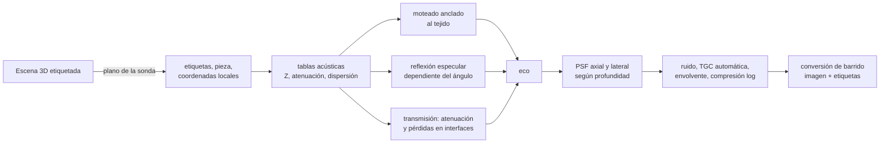
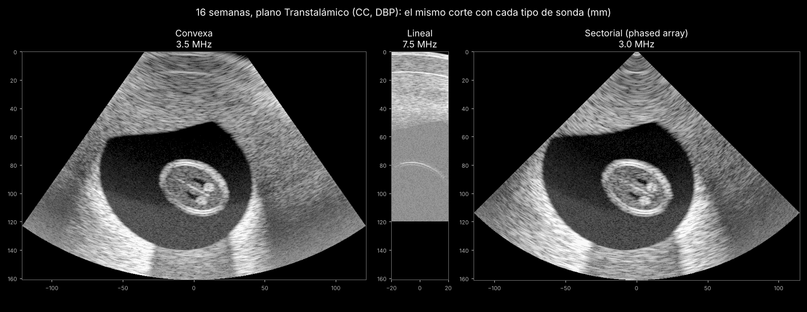
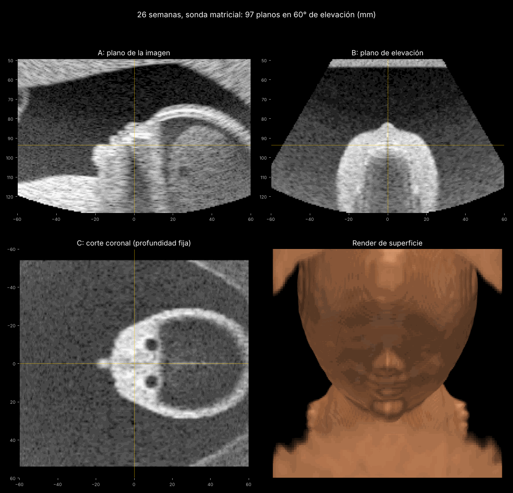
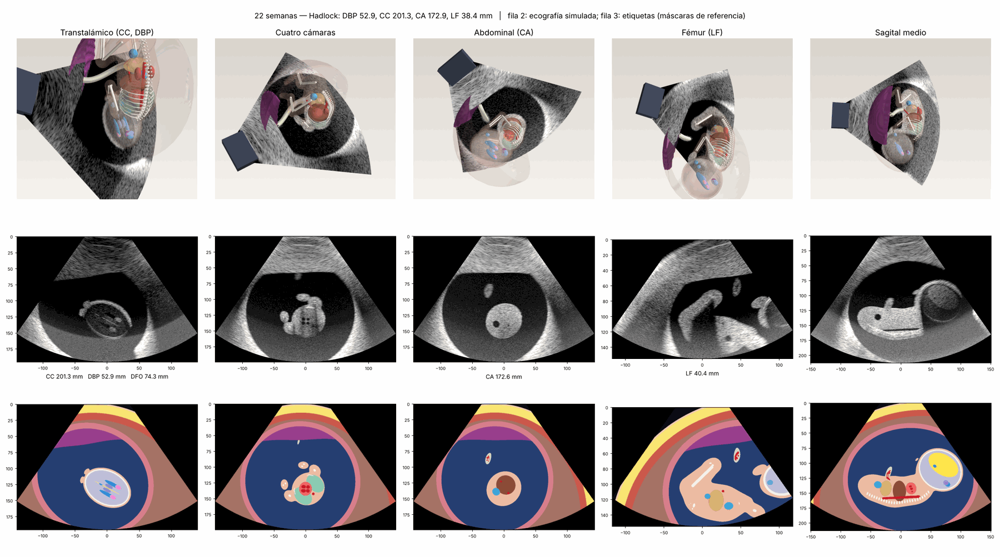
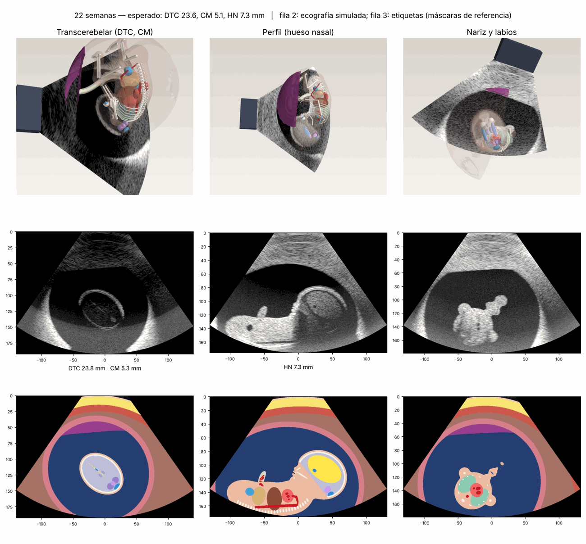
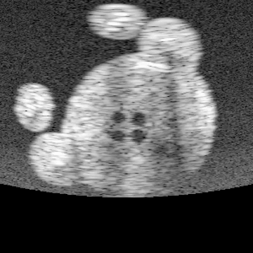

# Simulación de ecografía

**Español** · [English](ecografia.en.md)

`ecografia.py` simula imágenes modo B con un modelo de rayos y convolución: una sonda
(convexa, lineal o sectorial) apoyada en la piel materna muestrea un plano dentro de la
escena 3D etiquetada (`feto3d.Escena`).



## Etapas

| Etapa | Qué hace |
|---|---|
| Muestreo | la escena se evalúa en la malla del haz (líneas × profundidad), según la geometría de la sonda |
| Moteado | dispersores complejos con hash de las coordenadas locales 3D de cada pieza: el moteado se mueve con el feto y es determinista |
| Especular | derivada radial de ln Z ponderada por cosᵖ del ángulo entre el haz y la normal de la interfaz |
| Transmisión | atenuación de ida y vuelta + pérdidas por reflexión; produce sombra ósea y refuerzo posterior en líquidos |
| PSF | gaussiana axial (escala con 1/f₀) y lateral que crece al alejarse del foco |
| Receptor | ruido electrónico, TGC automática (compensa la atenuación mediana entre líneas, así el líquido amniótico queda negro), compresión logarítmica. En la sonda lineal la TGC no pasa de 50 dB (`Sonda.tgc_max_db`): más allá de su alcance la imagen se vuelve ruido, como en un equipo real |
| Salida | imagen cartesiana (sector o rectángulo) y mapa de etiquetas (máscaras de referencia) |
| Grosor de corte | opcional: suma coherente de varios planos en elevación (`Adquisicion(elevacion=(-1, 0, 1))`) |

## Tipos de sonda

`Sonda.geometria` elige cómo se reparten las líneas del haz; `sonda_tipo(geometria)` da
una sonda con los valores típicos de cada tipo y `sonda_para(pose, geometria=...)` la
ajusta a la profundidad del objetivo.

| Tipo | Líneas | Imagen | Frecuencia típica | Profundidad | Uso |
|---|---|---|---|---|---|
| `convexa` | abanico desde un arco de 50 mm de radio, 70° | sector con la parte superior curva | 3.5 MHz (2–6) | 160 mm (80–240) | exploración obstétrica de rutina |
| `lineal` | paralelas, repartidas en 40 mm | rectángulo | 7.5 MHz (5–12) | 70 mm (30–120) | estructuras cercanas a la pared: embarazo temprano, detalle superficial |
| `sectorial` | abanico desde una huella casi puntual, 90° | sector con vértice | 3.0 MHz (2–5) | 150 mm (60–240) | ventana acústica pequeña; ecocardiografía |
| `matricial` | como la convexa (radio 40 mm), más 60° en elevación | sector; volumen y biplano | 3.5 MHz (2–6) | 160 mm (80–240) | ecografía 3D/4D: cara, cortes ortogonales |

La lineal ve con más detalle (frecuencia alta: PSF más fina), pero la atenuación crece
con la frecuencia y no llega lejos: en la figura, con el mismo plano a 16 semanas, el
cráneo apenas asoma por debajo de la pared materna, entre el ruido. La sectorial
entra por una ventana pequeña a costa de un campo cercano estrecho.



## Sonda matricial: volumen y biplano

La sonda `matricial` (2D array) da la misma imagen que una convexa y, además, barre un
abanico de 60° en elevación. `volumen.simular_volumen` simula 97 planos inclinados
alrededor del eje lateral de la sonda (en paralelo, con la misma escala de grises que
el plano central) y los remuestrea a una rejilla cartesiana de 0.6 mm en una caja
alrededor del objetivo, con su volumen de etiquetas. Tarda unos 15 s.

* **Cortes ortogonales (MPR):** A, el plano de la imagen; B, el plano de elevación
  (perpendicular a A, con el mismo haz central); C, un corte coronal a profundidad fija.
  Se cruzan en un punto que se mueve con deslizadores o con un clic.
* **Render de superficie:** el volumen se suaviza (como el filtro de los equipos), se
  recorta por delante con una caja de render que empieza en el líquido amniótico frente
  al objetivo, y se dibuja con opacidad nula para lo oscuro (líquido) y opaca para el
  tejido, en tono sepia. Umbral e inicio de la caja se ajustan.
* **Biplano:** dos planos en vivo a 90° que comparten el haz central
  (`volumen.pose_biplano`), con la misma escala de grises.

Para ver la cara, el feto tiene que mirar a la sonda: en la figura, dorso posterior
(180°) y la cabeza algo extendida.



## Planos estándar

`plano_estandar(escena, nombre)` coloca la sonda en la piel desde donde se ve el
plano pedido, con el haz dentro del plano y lo más perpendicular posible a la pared
anterior materna:

| Nombre | Plano | Medida en la imagen |
|---|---|---|
| `transtalamico` | axial de la cabeza a la altura de los tálamos | CC, DBP, DFO |
| `transcerebelar` | oblicuo por el CSP y el cerebelo | DTC, CM (cisterna magna) |
| `cuatro_camaras` | axial del tórax a la altura del corazón | — |
| `abdominal` | axial del abdomen a la altura del estómago | CA |
| `femur` | plano que contiene el fémur más anterior | LF |
| `sagital` | sagital medio del tronco | — |
| `perfil` | sagital medio de la cara | HN (hueso nasal) |
| `nariz_labios` | coronal tangente a la cara, por la nariz y el mentón | — (labio superior, narinas) |

`medir_en_imagen` mide sobre el mapa de etiquetas de la imagen simulada (no sobre el
modelo), igual que se haría sobre una imagen real anotada.



Planos de la cabeza y la cara (`feto-eco cabeza`):



| Cine de cuatro cámaras (latido) | Etiquetas superpuestas en `feto-escaner` |
|---|---|
|  |  |

## Uso

```python
from feto_parametrico.feto3d import Escena, Materno
from feto_parametrico.movimiento import Movimiento
from feto_parametrico.ecografia import plano_estandar, simular, sonda_para, medir_en_imagen

mov = Movimiento(semilla=0)
esc = Escena(22, mov.en(1.5), mat=Materno(placenta="posterior"))
pose = plano_estandar(esc, "transtalamico")
res = simular(esc, pose, sonda_para(pose))
res["bmodo"], res["etiquetas"], medir_en_imagen(res, "transtalamico", 0.3, pose)
```

```bash
feto-eco planos --eg 22        # figura de los planos de biometría con medidas
feto-eco cabeza --eg 22        # transcerebelar, perfil y nariz-labios (DTC, CM, HN)
feto-eco latido --eg 22        # cine de 4 cámaras (latido y respiración)
feto-eco combinado --eg 22     # 3D + ecografía con la sonda fija y el feto moviéndose
feto-eco lote --n 200          # imágenes, etiquetas y JSON para entrenamiento
feto-eco planos --sonda lineal # los planos de biometría con otra sonda (lineal o sectorial)
feto-eco sondas                # un plano con las tres sondas (16 semanas por omisión)
feto-eco volumen               # sonda matricial: cortes A, B, C y render de la cara (26 semanas)
feto-eco planos --eg 22 --idioma en   # la figura con textos en inglés
```

El modo `lote` varía al azar la EG (18–34 semanas), la postura, la placenta, el grosor
de grasa materna, el plano (con inclinación de ±12°), la frecuencia, la ganancia y el
rango dinámico. Algunas muestras salen oscuras o mal colocadas, como las adquisiciones
fallidas reales; conviene filtrarlas si se usan para entrenar.

`lote` acepta también `--sonda`; la frecuencia se elige al azar dentro del intervalo
del tipo de sonda.

## Limitaciones

* Sin refracción, reverberación ni lóbulos laterales.
* Propiedades acústicas aproximadas, pensadas para un simulador didáctico.
* La LF medida sobre la imagen sale ~5 % larga (ver [validación](validacion.md)).
* Las cámaras cardiacas son pequeñas, así que el latido se ve sutil en el cine de 4 cámaras.
