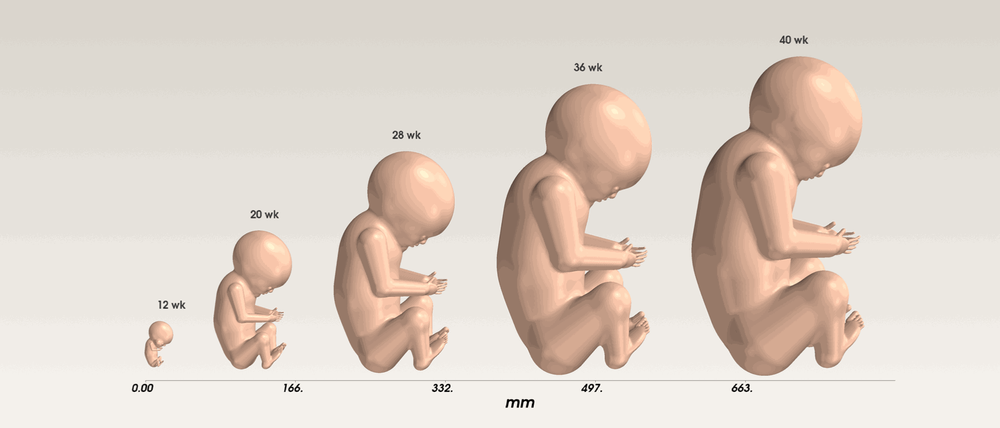
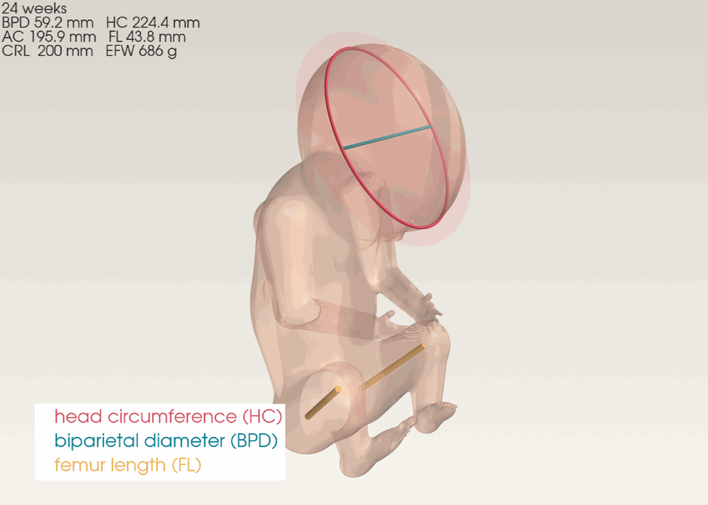
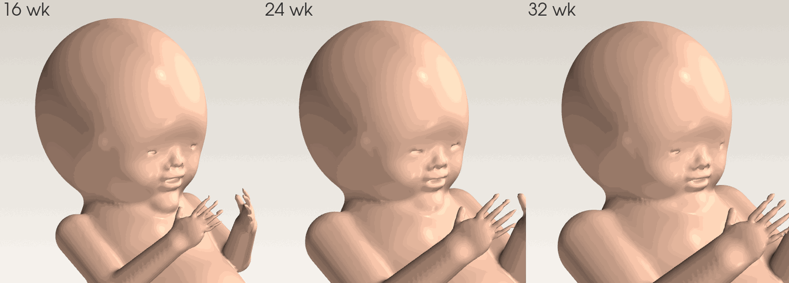
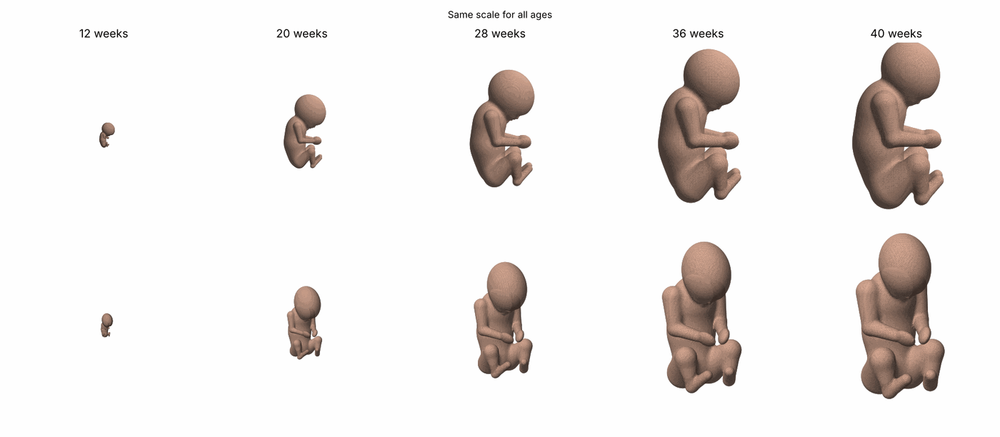

# The model

[Español](modelo.md) · **English**

Two levels of detail share the same body geometry:

* **Surface** (`superficie.py`): the fetal skin as a watertight triangle mesh, for
  export (STL/OBJ/PLY) or viewing in `feto-visor`.
* **3D scene** (`feto3d.py`): the articulated fetus with internal organs, inside a uterus
  with placenta, umbilical cord and maternal abdominal wall. Every point in space gets a
  tissue label; this is the input to the ultrasound simulator.

In the resting pose both build exactly the same body parts (a test checks this
indirectly: the organs stay inside the skin).

Code identifiers are in Spanish; see the glossary in the [English README](../README.en.md#glossary-of-spanish-names).

## Biometry

Gestational age (GA, `eg` in the code, in weeks) sets four measurements through the
regressions of Hadlock et al. [[1]](#ref-1), valid roughly from 12 to 40 weeks:

| Measurement | Regression (cm) |
|---|---|
| BPD | −3.08 + 0.41·GA − 0.000061·GA³ |
| HC | −11.48 + 1.56·GA − 0.0002548·GA³ |
| AC | −13.3 + 1.61·GA − 0.00998·GA² |
| FL | −3.91 + 0.427·GA − 0.0034·GA² |

The estimated fetal weight (EFW) comes from Hadlock et al. [[2]](#ref-2) using HC, AC and FL,
and is used to check the mesh volume.

## Geometry

| Part | How it is built |
|---|---|
| Skull | ellipsoid with transverse semi-axis BPD/2 and an occipitofrontal diameter chosen so that its perimeter (Ramanujan) equals HC: the **outer edge of the skull** matches Hadlock |
| Scalp | the head skin lies `1.2 + 0.02·BPD` mm outside the skull |
| Face | profile with nose, lips, chin, cheeks and eyelids (see [Face and posterior fossa](#face-and-posterior-fossa)); the head can flex, turn and tilt |
| Trunk | pelvis, abdomen and thorax along an arched spine; the abdominal cross-section has perimeter AC |
| Limbs | rounded cones; femur with 0.04·FL of cartilage at each end (the ossified shaft measures FL); tibia, humerus and ulna proportional to FL |
| Hands and feet | palm with four slightly spread three-phalanx fingers and a two-phalanx thumb, closed with `Postura.puno` (0 open, 1 fist); foot with heel, sole and five fanned toes (`extremidades.py`, shared with the 3D scene) |
| Foot | heel to toe = FL: FL/foot ratio ≈ 1 throughout gestation [[4]](#ref-4), [[5]](#ref-5), consistent with the term newborn foot [[6]](#ref-6); the ratio of 0.85 at term from [[3]](#ref-3) is not used (see [validation](validacion.en.md#foot)) |
| Surface | smooth union of signed distance functions (SDF) → marching cubes [[7]](#ref-7) → largest connected component → Taubin smoothing [[8]](#ref-8). Next to the skin the grid is twice as fine (`refinar=2`): the exact SDF is computed only within two voxels of the skin and interpolated elsewhere, so fingers and toes appear without paying for a full fine grid |

Proportions not covered by Hadlock (trunk length, limb thickness, flexion angles, etc.)
are heuristic and gathered in `Proporciones` so they can be edited.

## Organs (feto3d)

Head: calvarium (thickness from BPD), brain, falx, lateral ventricles with choroid
plexuses, thalami, cavum septi pellucidi, cerebellum (hemispheres and vermis), cisterna
magna, eyes with lens, orbits, nasal bone, maxilla, palate and mandible. Trunk:
four-chamber heart (axis at 40°), lungs, liver, stomach, umbilical vein, bowel, kidneys
and bladder. Great vessels: ascending aorta, arch and descending aorta; pulmonary trunk
and ductus arteriosus, reaching almost the same axial plane (the "V" of the
three-vessel view); superior vena cava and trachea. Umbilical arteries from the cord
insertion, on both sides of the bladder. Skeleton: spine (vertebral bodies and arches,
placed from the actual skin of the back so they stay inside the body at every age),
ribs, long bones (femur, tibia, fibula, humerus, ulna, radius), metacarpals,
metatarsals, phalanges and calcaneus.

Maternal scene: skin, fat (configurable thickness) and muscle of the abdominal wall,
myometrium, amniotic fluid, placenta (a lens against the wall: anterior, posterior,
fundal or lateral) and an umbilical cord with two arteries and one vein in a helix.
Presentation (cephalic/breech) and the position of the fetal back are parameters
(`Materno`).

The acoustic properties of each tissue (impedance, attenuation, scattering) are in
`tejidos.py`; bone properties change with ossification according to GA.

## Face and posterior fossa

The face and the posterior fossa live in `cabeza.py` (head), shared by the surface
and the 3D scene. Positions are given in the head frame, normalized by the skull
semi-axes, so the face grows with the head:

| Structure | How it is built |
|---|---|
| Profile | the skull skin is trimmed in front of the glabella–chin line; forehead, nasal bridge and tip, nasal alae, lips, chin, cheeks and eyelids are smoothly joined onto a base face |
| Mouth, nostrils, closed eyes | slits **subtracted** from the surface (smooth SDF subtraction) |
| Facial bones | nasal bone (length by GA, with prenasal skin 0.61 × its length), maxillary and mandibular arches, mandibular rami, hard palate, orbits open in front |
| Eyes | vitreous and lens (anechoic with a bright rim) |
| Vault | calvarium and brain stop at the skull base; the face lies below it |
| Posterior fossa | cerebellar hemispheres (hypoechoic) and vermis (echogenic) with the nomogram TCD; the cerebellum is placed so that, in the transcerebellar plane, the cisterna magna fills the gap between the vermis and the occipital bone |

Reference measurements:

* Transverse cerebellar diameter (TCD): `GA = 0.557·TCD + 8.84` [[9]](#ref-9).
* Nasal bone: from 5.7 mm at 18 weeks to 7.6 mm at 23 [[10]](#ref-10); prenasal thickness
  0.61 × nasal bone [[11]](#ref-11).
* Cisterna magna: 2.5 + 0.12·GA mm, within the normal 2–10 mm range.

The width of the face is not a fixed fraction of the skull: it is set by the binocular
(`BOD = 2.590 + 1.420·GA`) and interocular (`IOD = 2.304 + 0.510·GA`) distances measured
in 595 fetuses from 15 to 40 weeks [[12]](#ref-12), which agree with the MRI values [[13]](#ref-13)
(BOD 30.8 mm at 20 weeks). They give the spacing and size of the eyes, and eyelids,
cheeks, nose, lips, mouth, maxilla and mandible scale with them. Since BOD grows more
slowly than BPD, the face is relatively wider at mid-gestation than at term. The mandible
(temporomandibular joint to symphysis) follows Otto and Platt [[14]](#ref-14):
`ML = −2.41 + 0.297·GA − 0.0027·GA²` cm. Eyes and eyelids are placed under the actual
skin (face or skull, whichever is further forward), with the eyelid half a millimetre
proud.

## Movement

`Postura` (pose) controls the neck (flexion, turn, tilt), trunk curvature, hips, knees,
shoulders, elbows, breathing, cardiac phase and the global pose. `Movimiento.en(t)`
combines slow drift of every joint, kicks, arm startles, head turns, breathing episodes
(~0.9 Hz) and a heartbeat (140 bpm). The amplitudes are illustrative, not measured fetal
kinematics.

## Limitations

* Primitive-based anatomy (ellipsoids and capsules): schematic face, hands and feet,
  simplified organ shapes; no heart valves.
* Outside 12–40 weeks the regressions are extrapolated (the program warns).
* The heuristic proportions are a reasonable starting point, not an anatomical reference.

Preview without VTK (matplotlib only), `feto-vista-previa`:

## References

1. Hadlock FP, Deter RL, Harrist RB, Park SK. Estimating fetal age: computer-assisted analysis of multiple fetal growth parameters. *Radiology*. 1984;152(2):497–501. doi:[10.1148/radiology.152.2.6739822](https://doi.org/10.1148/radiology.152.2.6739822)
2. Hadlock FP, Harrist RB, Sharman RS, Deter RL, Park SK. Estimation of fetal weight with the use of head, body, and femur measurements—a prospective study. *Am J Obstet Gynecol*. 1985;151(3):333–337. doi:[10.1016/0002-9378(85)90298-4](https://doi.org/10.1016/0002-9378(85)90298-4)
3. Merz E, Oberstein A, Wellek S. Age-related reference ranges for fetal foot length. *Ultraschall Med*. 2000;21(2):79–85. doi:[10.1055/s-2000-12986](https://doi.org/10.1055/s-2000-12986)
4. Joshi KS, Marahatta SB, Karki S, Tamrakar SR, Shrestha NC. Fetal foot length and femur/foot length ratio: significance in Nepalese context. *Nepal J Radiol*. 2011;1(1):15–22. doi:[10.3126/njr.v1i1.6317](https://doi.org/10.3126/njr.v1i1.6317)
5. Ravisankar G, Sivalingam S, Keerthi B, et al. Estimation of fetal foot length and femur-to-foot length ratio in Indian population for estimating gestational age on sonography during second trimester (17–25 weeks). *Cureus*. 2025;17(5):e84515. doi:[10.7759/cureus.84515](https://doi.org/10.7759/cureus.84515)
6. Kuponiyi OT, Ogunlesi TA. Postnatal foot length in the estimation of gestational age in relation to intrauterine growth pattern among Nigerian neonates. *Ghana Med J*. 2023;57(3):234–240. doi:[10.4314/gmj.v57i3.11](https://doi.org/10.4314/gmj.v57i3.11)
7. Lorensen WE, Cline HE. Marching cubes: a high resolution 3D surface construction algorithm. *ACM SIGGRAPH Comput Graph*. 1987;21(4):163–169. doi:[10.1145/37402.37422](https://doi.org/10.1145/37402.37422)
8. Taubin G. A signal processing approach to fair surface design. In: *Proceedings of SIGGRAPH '95*. ACM; 1995. p. 351–358. doi:[10.1145/218380.218473](https://doi.org/10.1145/218380.218473)
9. Adelabu AO, Bello TO, Idowu BM, Oyedepo VO. Fetal gestational age estimation using ultrasonic transverse cerebellar diameter in a sub-Saharan African population. *J Med Ultrasound*. 2024;32(1):41–47. doi:[10.4103/jmu.jmu_116_22](https://doi.org/10.4103/jmu.jmu_116_22)
10. Papasozomenou P, Athanasiadis AP, Zafrakas M, Panteris E, Loufopoulos A, Assimakopoulos E, Tarlatzis BC. Fetal nasal bone length in the second trimester: comparison between population groups from different ethnic origins. *J Perinat Med*. 2016;44(2):229–235. doi:[10.1515/jpm-2014-0296](https://doi.org/10.1515/jpm-2014-0296)
11. de Jong-Pleij EAP, Vos FI, Ribbert LSM, Pistorius LR, Tromp E, Bilardo CM. Prenasal thickness-to-nasal bone length ratio: a strong and simple second- and third-trimester marker for trisomy 21. *Ultrasound Obstet Gynecol*. 2012;39(2):185–190. doi:[10.1002/uog.9047](https://doi.org/10.1002/uog.9047)
12. Sukonpan K, Phupong V. Fetal ocular distance in normal pregnancies. *J Med Assoc Thai*. 2008;91(9). Available from: <https://www.thaiscience.info/journals/Article/JMAT/10402636.pdf>
13. Velasco-Annis C, Gholipour A, Afacan O, Prabhu SP, Estroff JA, Warfield SK. Normative biometrics for fetal ocular growth using volumetric MRI reconstruction. *Prenat Diagn*. 2015;35(4):400–408. doi:[10.1002/pd.4558](https://doi.org/10.1002/pd.4558)
14. Otto C, Platt LD. The fetal mandible measurement: an objective determination of fetal jaw size. *Ultrasound Obstet Gynecol*. 1991;1(1):12–17. doi:[10.1046/j.1469-0705.1991.01010012.x](https://doi.org/10.1046/j.1469-0705.1991.01010012.x)
