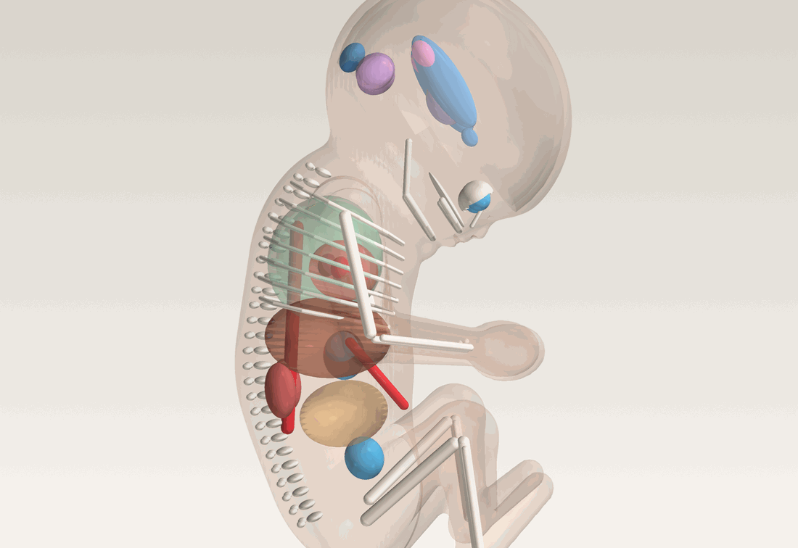
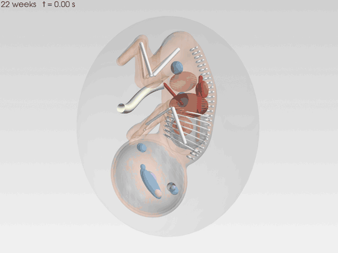

# The model

[Español](modelo.md) · **English**

Two levels of detail share the same body geometry:

* **Surface** (`superficie.py`): the fetal skin as a watertight triangle mesh, for
  export (STL/OBJ/PLY) or viewing in `feto-visor`.
* **3D scene** (`feto3d.py`): the articulated fetus with internal organs, inside a uterus
  with placenta, umbilical cord and maternal abdominal wall. Every point in space gets a
  tissue label; this is the input to the ultrasound simulator.

In the resting pose both build exactly the same body parts (a test checks this
indirectly: the organs stay inside the skin).

Code identifiers are in Spanish; see the glossary in the [English README](../README.en.md#glossary-of-spanish-names).

## Biometry

Gestational age (GA, `eg` in the code, in weeks) sets four measurements through the
regressions of Hadlock et al. ([1984](https://doi.org/10.1148/radiology.152.2.6739822)), valid roughly from 12 to 40 weeks:

| Measurement | Regression (cm) |
|---|---|
| BPD | −3.08 + 0.41·GA − 0.000061·GA³ |
| HC | −11.48 + 1.56·GA − 0.0002548·GA³ |
| AC | −13.3 + 1.61·GA − 0.00998·GA² |
| FL | −3.91 + 0.427·GA − 0.0034·GA² |

The estimated fetal weight (EFW) comes from Hadlock et al. ([1985](https://doi.org/10.1016/0002-9378(85)90298-4)) using HC, AC and FL,
and is used to check the mesh volume.

## Geometry

| Part | How it is built |
|---|---|
| Skull | ellipsoid with transverse semi-axis BPD/2 and an occipitofrontal diameter chosen so that its perimeter (Ramanujan) equals HC: the **outer edge of the skull** matches Hadlock |
| Scalp | the head skin lies `1.2 + 0.02·BPD` mm outside the skull |
| Face | face, nose and ears as smaller ellipsoids; the head can flex, turn and tilt |
| Trunk | pelvis, abdomen and thorax along an arched spine; the abdominal cross-section has perimeter AC |
| Limbs | rounded cones; femur with 0.04·FL of cartilage at each end (the ossified shaft measures FL); tibia, humerus and ulna proportional to FL |
| Foot | heel to toe = FL (FL/foot ratio = 1 throughout gestation) |
| Surface | smooth union of signed distance functions (SDF) → marching cubes → largest connected component → Taubin smoothing |

Proportions not covered by Hadlock (trunk length, limb thickness, flexion angles, etc.)
are heuristic and gathered in `Proporciones` so they can be edited.

## Organs (feto3d)

Head: calvarium (thickness from BPD), brain, falx, lateral ventricles with choroid
plexuses, thalami, cavum septi pellucidi, cerebellum, cisterna magna and eyes. Trunk:
four-chamber heart (axis at 40°), lungs, aorta, liver, stomach, umbilical vein, bowel,
kidneys and bladder. Skeleton: spine (vertebral bodies and arches, placed from the actual
skin of the back so they stay inside the body at every age), ribs and long bones (femur,
tibia, fibula, humerus, ulna, radius).

Maternal scene: skin, fat (configurable thickness) and muscle of the abdominal wall,
myometrium, amniotic fluid, placenta (a lens against the wall: anterior, posterior,
fundal or lateral) and an umbilical cord with two arteries and one vein in a helix.
Presentation (cephalic/breech) and the position of the fetal back are parameters
(`Materno`).

The acoustic properties of each tissue (impedance, attenuation, scattering) are in
`tejidos.py`; bone properties change with ossification according to GA.

## Movement

`Postura` (pose) controls the neck (flexion, turn, tilt), trunk curvature, hips, knees,
shoulders, elbows, breathing, cardiac phase and the global pose. `Movimiento.en(t)`
combines slow drift of every joint, kicks, arm startles, head turns, breathing episodes
(~0.9 Hz) and a heartbeat (140 bpm). The amplitudes are illustrative, not measured fetal
kinematics.

## Limitations

* Primitive-based anatomy (ellipsoids and capsules): no fingers, no detailed facial
  features, simplified organ shapes.
* Outside 12–40 weeks the regressions are extrapolated (the program warns).
* The heuristic proportions are a reasonable starting point, not an anatomical reference.

Preview without VTK (matplotlib only), `feto-vista-previa`:

