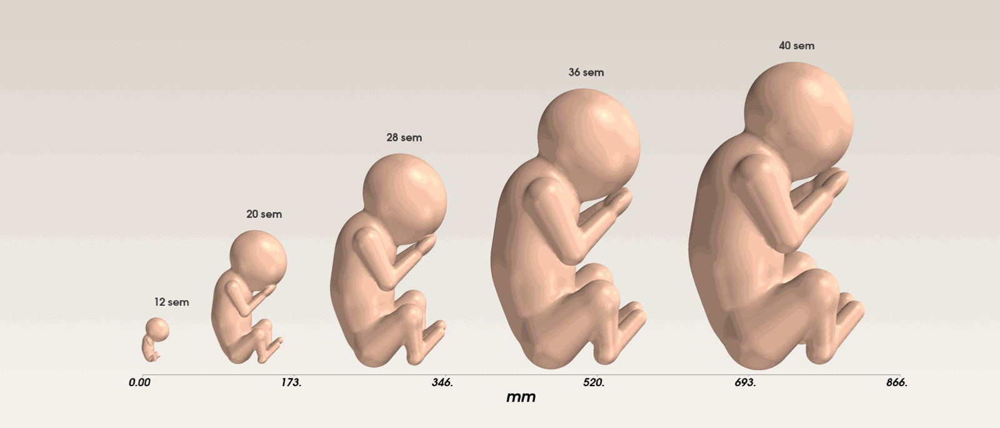
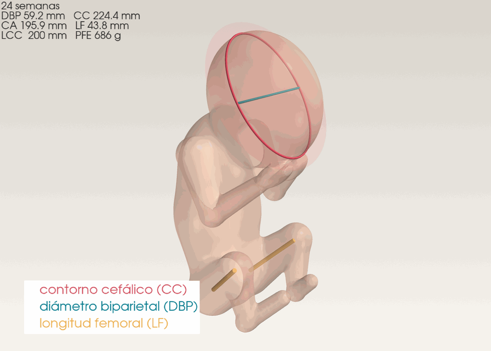

# El modelo

**Español** · [English](modelo.en.md)

Dos niveles de detalle comparten la misma geometría corporal:

* **Superficie** (`superficie.py`): la piel del feto como malla triangulada
  hermética, para exportar (STL/OBJ/PLY) o ver en `feto-visor`.
* **Escena 3D** (`feto3d.py`): el feto articulado con órganos, dentro de un útero
  con placenta, cordón y pared abdominal materna. Cada punto del espacio recibe una
  etiqueta de tejido; es la entrada del simulador de ecografía.

En postura de reposo, las dos construyen exactamente las mismas piezas corporales
(hay una prueba que lo comprueba indirectamente: los órganos quedan dentro de la piel).

## Biometría

La edad gestacional (EG, semanas) fija cuatro medidas con las regresiones de
Hadlock et al. (1984), válidas aproximadamente de 12 a 40 semanas:

| Medida | Regresión (cm) |
|---|---|
| DBP | −3.08 + 0.41·EG − 0.000061·EG³ |
| CC | −11.48 + 1.56·EG − 0.0002548·EG³ |
| CA | −13.3 + 1.61·EG − 0.00998·EG² |
| LF | −3.91 + 0.427·EG − 0.0034·EG² |

El peso fetal estimado (PFE) se calcula con Hadlock et al. (1985) a partir de CC,
CA y LF, y sirve para comprobar el volumen de la malla.

## Geometría

| Parte | Cómo se construye |
|---|---|
| Cráneo | elipsoide con semieje transverso DBP/2 y diámetro fronto-occipital tal que el perímetro (Ramanujan) es la CC: el **borde externo del cráneo** coincide con Hadlock |
| Cuero cabelludo | la piel de la cabeza está `1.2 + 0.02·DBP` mm por fuera del cráneo |
| Cara | cara, nariz y orejas como elipsoides menores; la cabeza puede flexionarse, girar e inclinarse |
| Tronco | pelvis, abdomen y tórax a lo largo de una columna en arco; la sección abdominal tiene perímetro CA |
| Extremidades | conos redondeados; fémur con 0.04·LF de cartílago en cada extremo (la diáfisis osificada mide LF); tibia, húmero y cúbito proporcionales al LF |
| Pie | talón a punta = LF / r, con r = 1 hasta las 24 semanas y 0.85 al término |
| Superficie | unión suave de funciones de distancia con signo (SDF) → marching cubes → pieza conexa mayor → suavizado de Taubin |

Las proporciones que no vienen de Hadlock (largo del tronco, grosor de las
extremidades, ángulos de flexión, etc.) son heurísticas y están reunidas en
`Proporciones`, para poder editarlas.

## Órganos (feto3d)

Cabeza: calota (grosor según DBP), encéfalo, hoz, ventrículos laterales con plexos
coroideos, tálamos, cavum del septum pellucidum, cerebelo, cisterna magna y ojos.
Tronco: corazón con 4 cámaras (eje a 40°), pulmones, aorta, hígado, estómago, vena
umbilical, intestino, riñones y vejiga. Esqueleto: columna (cuerpos y arcos
vertebrales, colocados a partir de la piel real de la espalda para que queden dentro
del cuerpo a toda edad), costillas y huesos largos (fémur, tibia, peroné, húmero,
cúbito, radio).

Escena materna: piel, grasa (grosor configurable) y músculo de la pared abdominal,
miometrio, líquido amniótico, placenta (lente adosada a la pared: anterior,
posterior, fúndica o lateral) y cordón con dos arterias y una vena en hélice.
Presentación (cefálica/podálica) y posición del dorso son parámetros (`Materno`).

Las propiedades acústicas de cada tejido (impedancia, atenuación, dispersión) están
en `tejidos.py`; el hueso cambia con la osificación según la EG.

## Movimiento

`Postura` controla cuello (flexión, giro, inclinación), curvatura del tronco,
caderas, rodillas, hombros, codos, respiración, fase cardiaca y la pose global.
`Movimiento.en(t)` combina deriva lenta de todas las articulaciones, patadas,
sobresaltos de brazos, giros de cabeza, episodios de respiración (~0.9 Hz) y latido
(140 lpm). Las amplitudes son ilustrativas, no medidas de cinemática fetal.

## Limitaciones

* Anatomía de primitivas (elipsoides y cápsulas): sin dedos, sin rasgos faciales
  detallados, órganos con formas simplificadas.
* Fuera de 12–40 semanas las regresiones se extrapolan (el programa lo avisa).
* Las proporciones heurísticas son un punto de partida razonable, no una referencia
  anatómica.

Vista previa sin VTK (sólo matplotlib), `feto-vista-previa`:

