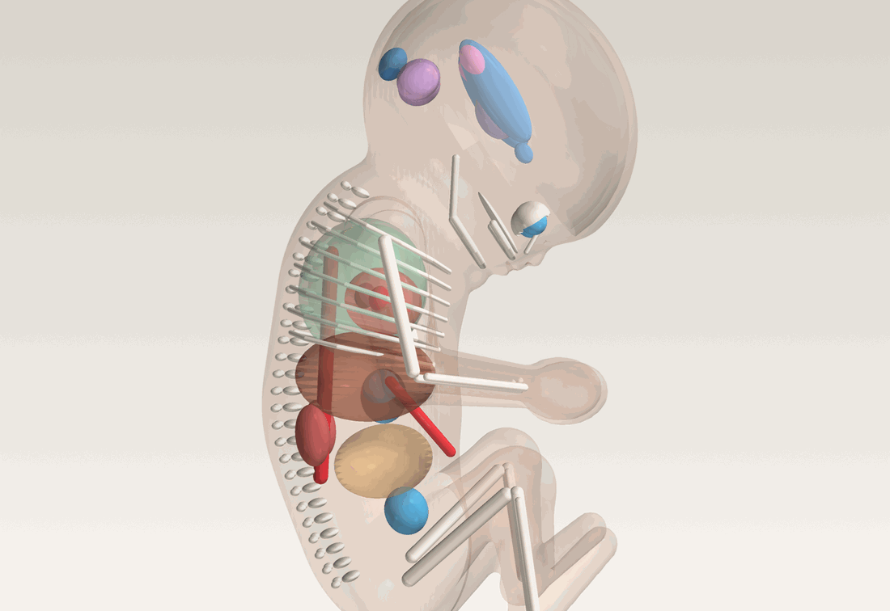
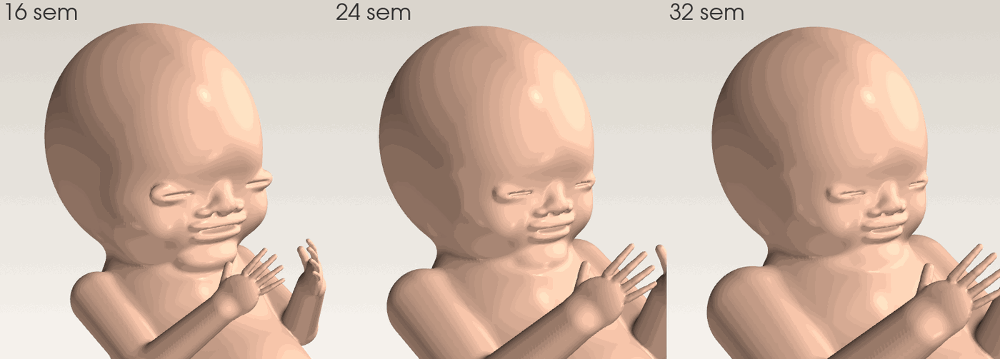
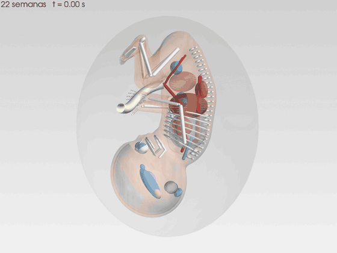
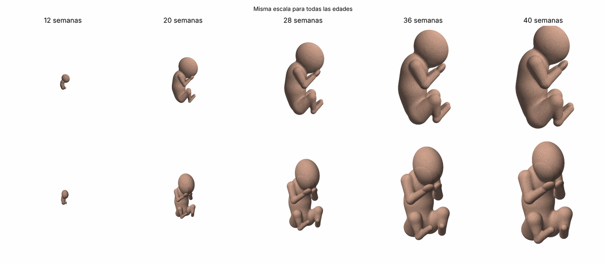

# El modelo

**Español** · [English](modelo.en.md)

Dos niveles de detalle comparten la misma geometría corporal:

* **Superficie** (`superficie.py`): la piel del feto como malla triangulada
  hermética, para exportar (STL/OBJ/PLY) o ver en `feto-visor`.
* **Escena 3D** (`feto3d.py`): el feto articulado con órganos, dentro de un útero
  con placenta, cordón y pared abdominal materna. Cada punto del espacio recibe una
  etiqueta de tejido; es la entrada del simulador de ecografía.

En postura de reposo, las dos construyen exactamente las mismas piezas corporales
(hay una prueba que lo comprueba indirectamente: los órganos quedan dentro de la piel).

## Biometría

La edad gestacional (EG, semanas) fija cuatro medidas con las regresiones de
Hadlock et al. [[1]](#ref-1), válidas aproximadamente de 12 a 40 semanas:

| Medida | Regresión (cm) |
|---|---|
| DBP | −3.08 + 0.41·EG − 0.000061·EG³ |
| CC | −11.48 + 1.56·EG − 0.0002548·EG³ |
| CA | −13.3 + 1.61·EG − 0.00998·EG² |
| LF | −3.91 + 0.427·EG − 0.0034·EG² |

El peso fetal estimado (PFE) se calcula con Hadlock et al. [[2]](#ref-2) a partir de CC, CA y
LF, y sirve para comprobar el volumen de la malla.

## Geometría

| Parte | Cómo se construye |
|---|---|
| Cráneo | elipsoide con semieje transverso DBP/2 y diámetro fronto-occipital tal que el perímetro (Ramanujan) es la CC: el **borde externo del cráneo** coincide con Hadlock |
| Cuero cabelludo | la piel de la cabeza está `1.2 + 0.02·DBP` mm por fuera del cráneo |
| Cara | perfil con nariz, labios, mentón, mejillas y párpados (ver [Cara y fosa posterior](#cara-y-fosa-posterior)); la cabeza puede flexionarse, girar e inclinarse |
| Tronco | pelvis, abdomen y tórax a lo largo de una columna en arco; la sección abdominal tiene perímetro CA |
| Extremidades | conos redondeados; fémur con 0.04·LF de cartílago en cada extremo (la diáfisis osificada mide LF); tibia, húmero y cúbito proporcionales al LF |
| Manos y pies | palma con cuatro dedos de tres falanges y pulgar de dos, algo separados, que se cierran con `Postura.puno` (0 abierta, 1 puño); pie con talón, planta y cinco ortejos en abanico (`extremidades.py`, compartido con la escena 3D) |
| Pie | talón a punta = LF: razón LF/pie ≈ 1 en toda la gestación [[4]](#ref-4), [[5]](#ref-5), coherente con el pie del recién nacido a término [[6]](#ref-6); la razón de 0.85 al término de [[3]](#ref-3) no se usa (ver [validación](validacion.md#pie)) |
| Superficie | unión suave de funciones de distancia con signo (SDF) → marching cubes [[7]](#ref-7) → pieza conexa mayor → suavizado de Taubin [[8]](#ref-8). Junto a la piel la rejilla es el doble de fina (`refinar=2`): la SDF exacta sólo se calcula a menos de dos vóxeles de la piel y el resto se interpola, así aparecen dedos y ortejos sin pagar una rejilla fina completa |

Las proporciones que no vienen de Hadlock (largo del tronco, grosor de las
extremidades, ángulos de flexión, etc.) son heurísticas y están reunidas en
`Proporciones`, para poder editarlas.

## Órganos (feto3d)

Cabeza: calota (grosor según DBP), encéfalo, hoz, ventrículos laterales con plexos
coroideos, tálamos, cavum del septum pellucidum, cerebelo (hemisferios y vermis),
cisterna magna, ojos con cristalino, órbitas, hueso nasal, maxilar, paladar y mandíbula.
Tronco: corazón con 4 cámaras (eje a 40°), pulmones, hígado, estómago, vena
umbilical, intestino, riñones y vejiga. Grandes vasos: aorta ascendente, arco y aorta
descendente; tronco de la pulmonar y ductus arterioso, que llegan casi en el mismo plano
axial (la «V» del plano de tres vasos); vena cava superior y tráquea. Arterias
umbilicales desde la inserción del cordón, a ambos lados de la vejiga. Esqueleto:
columna (cuerpos y arcos vertebrales, colocados a partir de la piel real de la espalda
para que queden dentro del cuerpo a toda edad), costillas, huesos largos (fémur, tibia,
peroné, húmero, cúbito, radio), metacarpianos, metatarsianos, falanges y calcáneo.

Escena materna: piel, grasa (grosor configurable) y músculo de la pared abdominal,
miometrio, líquido amniótico, placenta (lente adosada a la pared: anterior,
posterior, fúndica o lateral) y cordón con dos arterias y una vena en hélice.
Presentación (cefálica/podálica) y posición del dorso son parámetros (`Materno`).

Las propiedades acústicas de cada tejido (impedancia, atenuación, dispersión) están
en `tejidos.py`; el hueso cambia con la osificación según la EG.

## Cara y fosa posterior

La cara y la fosa posterior están en `cabeza.py`, compartidas por la superficie y la
escena 3D. Las posiciones van en el marco de la cabeza, normalizadas por los semiejes
del cráneo, así que la cara crece con la cabeza:

| Estructura | Cómo se construye |
|---|---|
| Perfil | la piel del cráneo se recorta por delante de la recta glabela-mentón; frente, dorso y punta de la nariz, alas nasales, labios, mentón, mejillas y párpados se unen suavemente sobre una cara base |
| Boca, narinas, ojos cerrados | hendiduras **restadas** de la superficie (sustracción suave de SDF) |
| Huesos de la cara | hueso nasal (largo según la EG, con piel prenasal de 0.61 × su largo), maxilar y mandíbula en arco, ramas mandibulares, paladar duro, órbitas abiertas por delante |
| Ojos | vítreo y cristalino (anecoico con borde brillante) |
| Bóveda | calota y encéfalo terminan en la base del cráneo; por debajo está la cara |
| Fosa posterior | hemisferios cerebelosos (hipoecoicos) y vermis (ecogénico) con el DTC del nomograma; el cerebelo se coloca de modo que, en el plano transcerebelar, entre el vermis y el occipital quede la cisterna magna |

Medidas de referencia:

* Diámetro transverso del cerebelo (DTC): `EG = 0.557·DTC + 8.84` [[9]](#ref-9).
* Hueso nasal: de 5.7 mm a las 18 semanas a 7.6 mm a las 23 [[10]](#ref-10); grosor prenasal
  0.61 × hueso nasal [[11]](#ref-11).
* Cisterna magna: 2.5 + 0.12·EG mm, dentro del intervalo normal de 2 a 10 mm.

El ancho de la cara no es una fracción fija del cráneo: lo fijan las distancias
binocular (`BOD = 2.590 + 1.420·EG`) e interocular (`IOD = 2.304 + 0.510·EG`) medidas en
595 fetos de 15 a 40 semanas [[12]](#ref-12), que coinciden con las de resonancia magnética
[[13]](#ref-13) (BOD 30.8 mm a las 20 semanas). De ellas salen la separación y el tamaño de los ojos, y
con ellas escalan párpados, mejillas, nariz, labios, boca, maxilar y mandíbula. Como la
BOD crece más despacio que el DBP, a mitad de la gestación la cara es relativamente más
ancha que al término. La mandíbula (articulación temporomandibular a sínfisis) sigue a
Otto y Platt [[14]](#ref-14): `ML = −2.41 + 0.297·EG − 0.0027·EG²` cm. Los ojos y los párpados se
colocan bajo la piel real (cara o cráneo, la que quede más adelante), con el párpado
asomando medio milímetro.

## Movimiento

`Postura` controla cuello (flexión, giro, inclinación), curvatura del tronco,
caderas, rodillas, hombros, codos, respiración, fase cardiaca y la pose global.
`Movimiento.en(t)` combina deriva lenta de todas las articulaciones, patadas,
sobresaltos de brazos, giros de cabeza, episodios de respiración (~0.9 Hz) y latido
(140 lpm). Las amplitudes son ilustrativas, no medidas de cinemática fetal.

## Limitaciones

* Anatomía de primitivas (elipsoides y cápsulas): rasgos faciales, manos y pies
  esquemáticos, órganos con formas simplificadas; sin válvulas cardiacas.
* Fuera de 12–40 semanas las regresiones se extrapolan (el programa lo avisa).
* Las proporciones heurísticas son un punto de partida razonable, no una referencia
  anatómica.

Vista previa sin VTK (sólo matplotlib), `feto-vista-previa`:

## Referencias

1. Hadlock FP, Deter RL, Harrist RB, Park SK. Estimating fetal age: computer-assisted analysis of multiple fetal growth parameters. *Radiology*. 1984;152(2):497–501. doi:[10.1148/radiology.152.2.6739822](https://doi.org/10.1148/radiology.152.2.6739822)
2. Hadlock FP, Harrist RB, Sharman RS, Deter RL, Park SK. Estimation of fetal weight with the use of head, body, and femur measurements—a prospective study. *Am J Obstet Gynecol*. 1985;151(3):333–337. doi:[10.1016/0002-9378(85)90298-4](https://doi.org/10.1016/0002-9378(85)90298-4)
3. Merz E, Oberstein A, Wellek S. Age-related reference ranges for fetal foot length. *Ultraschall Med*. 2000;21(2):79–85. doi:[10.1055/s-2000-12986](https://doi.org/10.1055/s-2000-12986)
4. Joshi KS, Marahatta SB, Karki S, Tamrakar SR, Shrestha NC. Fetal foot length and femur/foot length ratio: significance in Nepalese context. *Nepal J Radiol*. 2011;1(1):15–22. doi:[10.3126/njr.v1i1.6317](https://doi.org/10.3126/njr.v1i1.6317)
5. Ravisankar G, Sivalingam S, Keerthi B, et al. Estimation of fetal foot length and femur-to-foot length ratio in Indian population for estimating gestational age on sonography during second trimester (17–25 weeks). *Cureus*. 2025;17(5):e84515. doi:[10.7759/cureus.84515](https://doi.org/10.7759/cureus.84515)
6. Kuponiyi OT, Ogunlesi TA. Postnatal foot length in the estimation of gestational age in relation to intrauterine growth pattern among Nigerian neonates. *Ghana Med J*. 2023;57(3):234–240. doi:[10.4314/gmj.v57i3.11](https://doi.org/10.4314/gmj.v57i3.11)
7. Lorensen WE, Cline HE. Marching cubes: a high resolution 3D surface construction algorithm. *ACM SIGGRAPH Comput Graph*. 1987;21(4):163–169. doi:[10.1145/37402.37422](https://doi.org/10.1145/37402.37422)
8. Taubin G. A signal processing approach to fair surface design. En: *Proceedings of SIGGRAPH '95*. ACM; 1995. p. 351–358. doi:[10.1145/218380.218473](https://doi.org/10.1145/218380.218473)
9. Adelabu AO, Bello TO, Idowu BM, Oyedepo VO. Fetal gestational age estimation using ultrasonic transverse cerebellar diameter in a sub-Saharan African population. *J Med Ultrasound*. 2024;32(1):41–47. doi:[10.4103/jmu.jmu_116_22](https://doi.org/10.4103/jmu.jmu_116_22)
10. Papasozomenou P, Athanasiadis AP, Zafrakas M, Panteris E, Loufopoulos A, Assimakopoulos E, Tarlatzis BC. Fetal nasal bone length in the second trimester: comparison between population groups from different ethnic origins. *J Perinat Med*. 2016;44(2):229–235. doi:[10.1515/jpm-2014-0296](https://doi.org/10.1515/jpm-2014-0296)
11. de Jong-Pleij EAP, Vos FI, Ribbert LSM, Pistorius LR, Tromp E, Bilardo CM. Prenasal thickness-to-nasal bone length ratio: a strong and simple second- and third-trimester marker for trisomy 21. *Ultrasound Obstet Gynecol*. 2012;39(2):185–190. doi:[10.1002/uog.9047](https://doi.org/10.1002/uog.9047)
12. Sukonpan K, Phupong V. Fetal ocular distance in normal pregnancies. *J Med Assoc Thai*. 2008;91(9). Disponible en: <https://www.thaiscience.info/journals/Article/JMAT/10402636.pdf>
13. Velasco-Annis C, Gholipour A, Afacan O, Prabhu SP, Estroff JA, Warfield SK. Normative biometrics for fetal ocular growth using volumetric MRI reconstruction. *Prenat Diagn*. 2015;35(4):400–408. doi:[10.1002/pd.4558](https://doi.org/10.1002/pd.4558)
14. Otto C, Platt LD. The fetal mandible measurement: an objective determination of fetal jaw size. *Ultrasound Obstet Gynecol*. 1991;1(1):12–17. doi:[10.1046/j.1469-0705.1991.01010012.x](https://doi.org/10.1046/j.1469-0705.1991.01010012.x)
